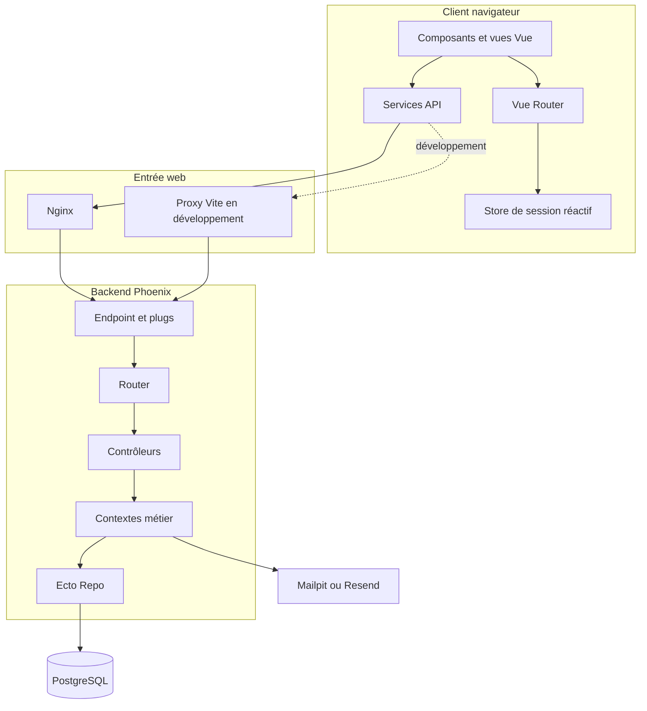
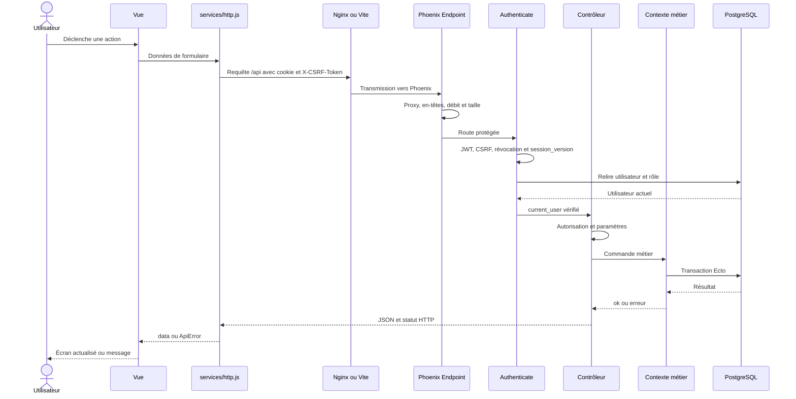
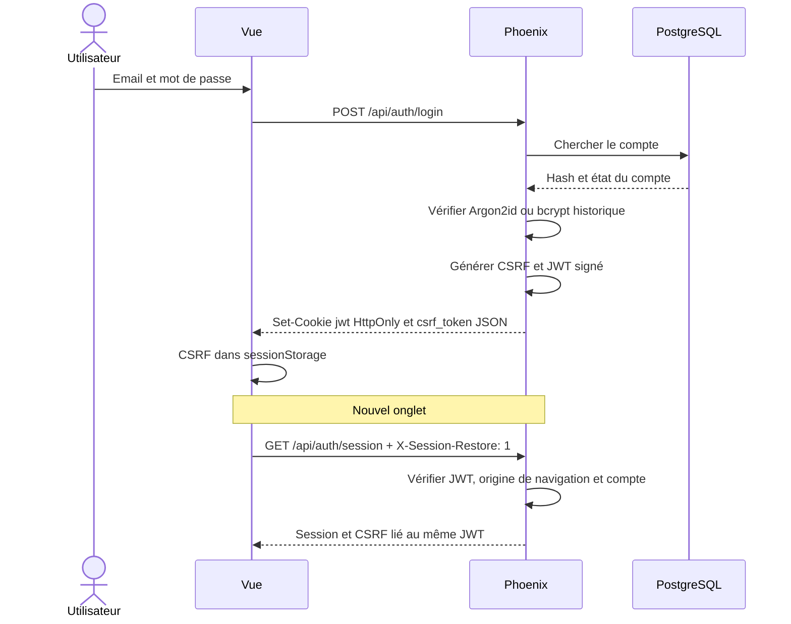
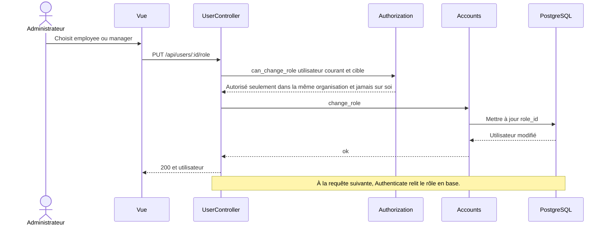
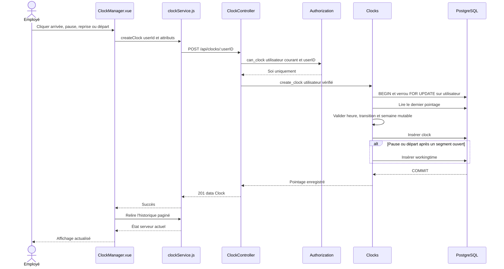
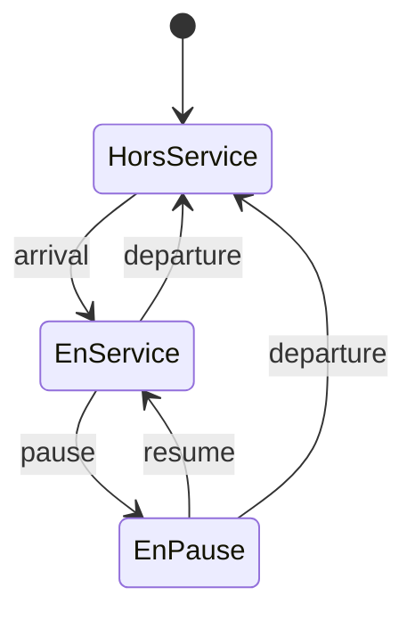
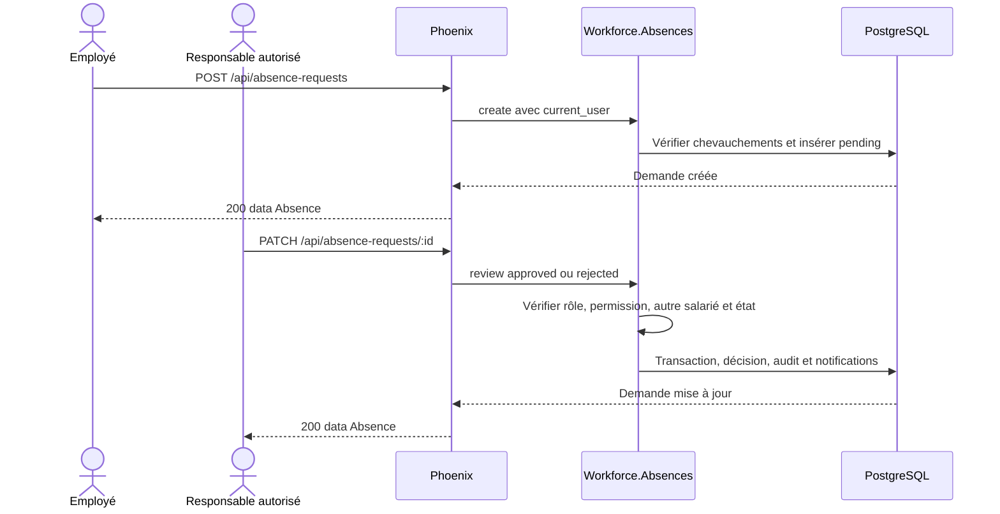

# Architecture et flux

Cette page raconte les principaux trajets dans l'application. Les schémas sont construits à partir du routeur Phoenix, des contrôleurs, des contextes, des services Vue et des fichiers Docker du dépôt.

Dans un diagramme de séquence, lisez de haut en bas : chaque flèche est un message envoyé au composant suivant. Dans un diagramme d'architecture, suivez les flèches depuis l'utilisateur jusqu'à PostgreSQL.

## Vue logique



Le frontend aide l'utilisateur, mais Phoenix reste l'autorité. Les gardes Vue masquent les pages inadaptées ; chaque endpoint répète les contrôles avec l'utilisateur relu en base.

## Cycle d'une requête API protégée

Ce premier parcours sert de modèle pour presque toutes les actions connectées. Le navigateur présente la session, Phoenix retrouve l'utilisateur actuel, le contrôleur vérifie le droit demandé et le contexte effectue l'opération.



## Connexion et restauration de session

La connexion crée la session. La restauration permet à un nouvel onglet de retrouver cette session sans redemander le mot de passe, tout en recréant la preuve CSRF liée au même JWT.



Le JWT dure huit heures. La déconnexion révoque son `jti`. Un changement ou une réinitialisation du mot de passe incrémente `session_version`, ce qui invalide les anciennes sessions.

## Gestion d'un utilisateur et changement de rôle

Le rôle enregistré dans le JWT ne suffit pas à accorder un droit. `Authenticate` relit le compte en base à chaque requête. Une rétrogradation est donc visible dès l'appel suivant.



Une rétrogradation prend donc effet sans attendre l'expiration du JWT. Pour les équipes, `TeamController` exige également que l'appelant possède encore le rôle actif `manager`.

## Voyage d'un pointage

Ce scénario part du clic dans `ClockManager.vue` et va jusqu'à l'écriture en base. Le verrou posé sur l'utilisateur évite que deux clics très proches créent deux transitions incohérentes.



Transitions autorisées :



Le verrou utilisateur sérialise deux clics concurrents. Le second relit l'état créé par le premier et une transition identique est refusée.

## Demande d'absence



## Conteneurs du serveur HTTP

```mermaid
flowchart LR
    Client local ou réseau isolé -->|HTTP| N[Nginx dashboard]
    N -->|proxy interne| P[Phoenix]
    P -->|réseau database interne| DB[(PostgreSQL)]
    P -->|réseau outbound| R[Resend]

    subgraph Hôte Docker
      N
      P
      DB
    end
```

- `db` n'a aucun port publié ;
- `phoenix` n'a aucun port publié ;
- `dashboard` est le seul point d'entrée ;
- Mailpit n'existe pas dans la composition de production ;
- aucun certificat ni port chiffré n'est configuré.

## Invariants d'architecture

1. Le navigateur ne décide jamais d'une autorisation.
2. Les identifiants d'URL sont comparés à l'utilisateur authentifié et au périmètre courant.
3. Les propriétaires (`user_id`, organisation) sont fixés côté serveur pour les écritures sensibles.
4. Les mutations liées sont regroupées en transaction.
5. Les mocks sont explicitement limités au développement et refusés au build.
6. Les secrets sont lus au démarrage, jamais intégrés au bundle Vue.

## Points à confirmer hors dépôt

- topologie réseau réelle du serveur et règles de pare-feu ;
- solution de transport chiffré à ajouter avant toute exposition publique ;
- nombre réel d'instances Phoenix ;
- supervision, collecte des logs et alertes ;
- application mobile consommant éventuellement cette API.
