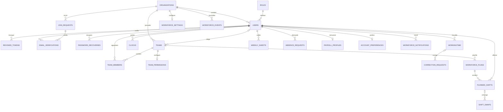

# Backend — comprendre Phoenix et l'API

Cette page explique le code présent dans `Theme_5_authentification_security/time_manager`, revu le **15 octobre 2026**. Elle sert à retrouver où une requête est contrôlée, où une règle métier est appliquée et où la donnée est enregistrée. La version d'un serveur dépend du code réellement déployé. Les chemins cités ci-dessous partent de `time_manager/`.

Le trajet général tient en quatre étapes : **le routeur choisit le chemin, le contrôleur contrôle la demande, le contexte applique la règle métier et Ecto parle à PostgreSQL**. Gardez ce fil en tête lorsque vous parcourez les sections détaillées.

L'API couvre l'admission à Gotham City, les comptes, les équipes, les pointages, les heures, les corrections, les validations, les plannings, les échanges, les absences, la paie, les préférences et les notifications. Elle est écrite en **Elixir/Phoenix**, servie par **Bandit** et utilise **Ecto/PostgreSQL** pour les données.

## 1. Comment le backend est organisé

### 1.1 Un projet rangé par domaines métier

Le backend est une seule application Phoenix, organisée par domaines métier. Les comptes, équipes, pointages et plannings possèdent chacun leur contexte. La couche web reçoit les requêtes avec le routeur et les contrôleurs, puis les modules `*JSON` préparent les réponses destinées au frontend.

Un contexte ressemble à un responsable de service : il connaît les règles de son domaine et coordonne les écritures. Un contrôleur reste bref ; il identifie la demande, vérifie le périmètre, puis confie le travail au bon contexte.

Ce n'est pas une Clean Architecture stricte : les contextes utilisent directement Ecto et `Repo`, sans interfaces de repository indépendantes.

| Couche | Emplacement | Responsabilité |
|---|---|---|
| Entrée HTTP | `lib/time_manager_web/endpoint.ex`, `router.ex`, `plugs/` | Décoder la requête, vérifier origine/session, sélectionner l'action. |
| Contrôleurs et présentation | `lib/time_manager_web/controllers/` | Lire les paramètres, contrôler l'accès, appeler le métier, produire statut et JSON. |
| Contextes métier | `lib/time_manager/*.ex`, `workforce/` | Règles, transitions, périmètres, transactions et calculs. |
| Données | Schémas Ecto des sous-dossiers métier, `repo.ex` | Décrire les tables, valider les modifications et exécuter les requêtes. |
| Infrastructure | `config/`, `application.ex`, `priv/repo/` | Configuration, supervision OTP, migrations et données de référence. |

Un **changeset** est la fiche de contrôle d'une donnée : il convertit les paramètres et vérifie les champs, les formats et les contraintes. Il ne sauvegarde rien à lui seul. `Repo.insert/update/delete` effectue l'écriture. Le contexte orchestre les opérations plus larges, par exemple `Clocks.create_clock/2` ou `Workforce.Planning.publish/3`.

### 1.2 Flux du client à la base

Voici le chemin suivi par une requête ordinaire. Chaque niveau a une responsabilité précise, ce qui permet de retrouver plus vite l'origine d'un refus ou d'une erreur.

```text
Client Vue / client HTTP
  → proxy Vite ou Nginx pour /api
  → Bandit → Endpoint : parsing JSON, identifiant de requête, télémétrie
  → Router : pipelines :api puis :auth pour les routes protégées
  → CheckOrigin → Authenticate → conn.assigns.current_user
  → Controller → Authorization / Workforce → contexte métier
  → Ecto.Query / Changeset → Repo → PostgreSQL
  → *JSON ou json(conn, %{data: résultat}) → réponse HTTP
```

Le proxy n'est pas obligatoire pour un client serveur. Il permet au navigateur d'appeler l'API sur l'hôte du frontend et de transmettre le cookie.

Extrait réel de `controllers/clock_controller.ex` :

```elixir
def create(conn, %{"clock" => attrs}) when is_map(attrs) do
  with {:ok, user_id} <- cast_id(conn.path_params["userID"]),
       :ok <- authorize(Authorization.can_clock?(current_user(conn), user_id)),
       {:ok, user} <- Accounts.fetch_user(user_id),
       {:ok, clock} <- Clocks.create_clock(user, attrs) do
    conn
    |> put_status(:created)
    |> render(:show, clock: clock)
  end
end
```

Le contrôleur vérifie l'appelant ; `Clocks` verrouille le salarié, vérifie la transition, insère le pointage et ferme éventuellement une période travaillée dans la même transaction. `ClockJSON` choisit les champs retournés. Une erreur du `with` est traduite par `FallbackController`.

!!! note "À retenir"
    Le routeur dirige, le contrôleur protège l'entrée, le contexte décide selon le métier et `Repo` écrit. Une règle importante placée uniquement dans Vue pourrait être contournée par un appel direct à l'API.

### 1.3 Sécurité et cohérence

- `Token` signe un JWT **HS256**, valable huit heures, contenant notamment `user_id`, `role`, `xsrf`, `jti`. Il est signé, pas chiffré.
- `AuthController` place le JWT dans le cookie `jwt`, `HttpOnly`, `SameSite=Strict`, chemin `/`. Le cookie est automatiquement `Secure` en production ; `COOKIE_SECURE=true` permet aussi de l'imposer ailleurs.
- `Authenticate` exige cookie et `X-CSRF-Token`, y compris sur les GET métier. La seule exception est la restauration en lecture seule de `/auth/session` avec `X-Session-Restore: 1`. Il vérifie signature, expiration, révocation et correspondance CSRF, puis recharge utilisateur et rôle en base.
- `Authorization` définit rôle et périmètre. `Workforce` ajoute les permissions `correct`, `validate`, `publish` des équipes.
- Le manager intervient sur les membres des équipes qu'il dirige actuellement ; l'administrateur dans son organisation. Aucun responsable ne corrige directement ses propres périodes ni ne valide sa propre feuille, correction ou absence.
- `Repo.transact` et les verrous de lignes protègent les mutations concurrentes. Les validations groupées verrouillent les salariés par ID croissant. Le planning vérifie `revision` ; publication et modification des règles partagent un verrou d'organisation.
- Les requêtes construites avec `Ecto.Query` paramètrent les valeurs utilisateur au lieu de concaténer du SQL. Aucun moteur NoSQL n'est présent. Toute future requête SQL brute devra faire l'objet d'une revue spécifique.

La déconnexion inscrit le `jti` dans `revoked_tokens`. Un rôle modifié ou un compte supprimé est pris en compte dès la requête suivante. Les comptes historiques sans organisation restent dans un espace distinct ; ils ne sont pas automatiquement rattachés à Gotham City.

### 1.4 Supervision OTP

`TimeManager.Application` démarre les enfants avec une stratégie `:one_for_one` :

| Processus supervisé | Rôle |
|---|---|
| `TimeManagerWeb.Telemetry` | Mesures VM, base et endpoint. |
| `TimeManager.Repo` | Connexions Ecto vers PostgreSQL. |
| `Task.Supervisor` nommé `TimeManager.EmailTasks` | Tâches d'envoi de courriel, limitées à 100 enfants. |
| `DNSCluster` | Découverte optionnelle de nœuds par DNS. |
| `Phoenix.PubSub` | Bus de messages Phoenix. |
| `TimeManagerWeb.RateLimiter` | Propriétaire de la table ETS des limites. |
| `TimeManagerWeb.Endpoint` | Serveur HTTP Bandit et chaîne de plugs. |

Avec `:one_for_one`, la panne d'un enfant redémarre cet enfant sans redémarrer automatiquement les autres. Le stockage ETS du limiteur est donc perdu si son processus ou le nœud redémarre.

## 2. Organisation des fichiers

Cette arborescence est une carte de lecture. Pour comprendre une fonctionnalité, commencez par sa route, suivez le contrôleur, puis ouvrez le contexte et enfin le schéma ou la migration concernés.

```text
time_manager/
├── mix.exs / mix.lock                 Projet, dépendances et alias Mix
├── Dockerfile / entrypoint.sh         Construction et démarrage du conteneur
├── config/
│   ├── config.exs                     Configuration commune
│   ├── dev.exs / test.exs / prod.exs   Configuration selon MIX_ENV
│   └── runtime.exs                    Variables et secrets lus au démarrage
├── lib/
│   ├── time_manager.ex               Module d'entrée du domaine
│   ├── time_manager_web.ex           Macros partagées : controller, router, etc.
│   ├── time_manager/
│   │   ├── application.ex / repo.ex  Supervision OTP et dépôt Ecto
│   │   ├── accounts.ex               Comptes, mots de passe, sessions et vérification email
│   │   ├── accounts/                 User, Role, Profile, RevokedToken, EmailVerification
│   │   ├── organizations.ex          Provisionnement interne et demandes d'adhésion
│   │   ├── organizations/            Organization et JoinRequest
│   │   ├── authorization.ex          Droits généraux et isolation des organisations
│   │   ├── token.ex                  Signature JWT et génération CSRF
│   │   ├── teams.ex / teams/         Gestion et schéma des équipes
│   │   ├── clocks.ex / clocks/       Machine à états et schéma des pointages
│   │   ├── working_times.ex          Écriture et lecture des périodes
│   │   ├── working_times/            Schéma WorkingTime et validations
│   │   ├── workforce.ex             Règles, permissions, verrouillage, audit, préférences
│   │   ├── workforce/
│   │   │   ├── time_sheets.ex        Notes, validation/clôture et corrections
│   │   │   ├── planning.ex           Plannings, gardes, publication et échanges
│   │   │   ├── absences.ex           Demandes, décisions et heures rémunérables
│   │   │   ├── payroll.ex            Calcul mensuel, taux et CSV
│   │   │   └── autres *.ex           Schémas Ecto : Sheet, Plan, Shift, Swap, etc.
│   │   └── email*.ex / mailer.ex / resend.ex  Construction et transport des emails
│   └── time_manager_web/
│       ├── endpoint.ex / router.ex   Chaîne HTTP, routes et pipelines
│       ├── api_spec.ex               Spécification OpenAPI issue du routeur
│       ├── plugs/                    Authenticate, CheckOrigin et RateLimit
│       ├── rate_limiter.ex           Compteurs de limitation, en mémoire sur ce nœud
│       ├── controllers/              Actions HTTP, *JSON, Authz et FallbackController
│       ├── schemas/                  Descriptions OpenAPI, distinctes des schémas Ecto
│       └── telemetry.ex / gettext.ex Mesures et infrastructure Phoenix
├── priv/
│   ├── repo/migrations/              Évolution versionnée du schéma PostgreSQL
│   ├── repo/seeds.exs                Rôles et premier compte administrateur
│   └── static/                       Ressources statiques du backend
└── test/
    ├── support/                      DataCase, ConnCase et fixtures
    ├── time_manager/                 Tests métier et concurrence PostgreSQL
    └── time_manager_web/             Tests HTTP, autorisations, plugs et OpenAPI
```

`workforce/planning.ex` est un contexte ; `workforce/plan.ex` est un schéma. Les **middlewares** sont les plugs. Les fonctions habituellement appelées « services » résident dans les contextes et modules d'infrastructure ; il n'existe pas de dossier backend `services/`.

| Domaine | Tables principales | Relations |
|---|---|---|
| Identité | roles, users, organizations | Utilisateur → rôle/organisation ; organisation identifiée par UUID. |
| Admission/session | join_requests, email_verifications, revoked_tokens | Demandes, codes email et sessions révoquées. |
| Équipes | teams, team_members, team_permissions | Manager, membres et permissions d'équipe. |
| Temps | clocks, workingtime, weekly_sheets, correction_requests | Événements, intervalles, état hebdomadaire et corrections proposées. |
| Planning | workforce_plans, planned_shifts, shift_swaps | Brouillon/version publiée, affectations et échanges. |
| Absences/paie | absence_requests, payroll_profiles | Absences, heures rémunérables et taux personnel. |
| Réglages/suivi | workforce_settings, account_preferences, workforce_events, workforce_notifications | Règles, préférences, historique et notifications. |

Les migrations portent clés étrangères, index uniques et contraintes. La suppression d'un compte supprime ses données opérationnelles selon ces relations ; certaines références d'acteurs/relecteurs conservées deviennent `null`. Consulter les migrations pour les cascades exactes.

### Modèle de données PostgreSQL

Le diagramme montre les relations structurantes ; les migrations restent la source de vérité pour chaque colonne, index et cascade.



`email_verifications` possède exactement un propriétaire selon les migrations actuelles : un utilisateur **ou** une demande d'adhésion. Cette contrainte permet de vérifier une adresse avant la création du compte tout en préservant le parcours historique des comptes existants.

## 3. Fichiers clés et implémentation des fonctionnalités

| Fichier critique | Logique à rechercher |
|---|---|
| accounts.ex, accounts/user.ex, accounts/profile.ex | Identité, Argon2id, compatibilité bcrypt, changement de mot de passe et dernier administrateur. |
| organizations.ex | Création interne d'organisation/admin, nom normalisé, référence privée, approbation atomique et employé par défaut. |
| authorization.ex, workforce.ex | Périmètres, flags des managers, règles, préférences, audit, notifications et semaines verrouillées. |
| teams.ex | Composition, manager, appartenance et équipes gérées. |
| clocks.ex | Transitions arrival/pause/resume/departure, départ oublié sur sept jours et création atomique des périodes. |
| working_times.ex, working_times/working_time.ex | Durées positives, fin non future, chevauchements et catégories work/oncall/recup. |
| workforce/time_sheets.ex | Notes ; open → validated → closed ; réouverture ; corrections avec vérification des horaires d'origine. |
| workforce/planning.ex | Revision, copie publiée, quotas, délai, absences/chevauchements et consentement avant échange. |
| workforce/absences.ex | pending/approved/rejected/cancelled et confirmation de payable_hours. |
| workforce/payroll.ex | Découpage UTC, majorations exclusives, rémunération d'absence, Decimal et CSV. |
| controllers/workforce_controller.ex | Adaptateur HTTP commun des workflows ; délégation aux contextes. |
| controllers/*_json.ex, fallback_controller.ex | Forme publique des objets, confidentialité et erreurs HTTP. |

Mots de passe : **8 à 128 caractères**, avec refus des valeurs courantes, numériques ou répétitives (`accounts/password_policy.ex`), nouveaux hashes Argon2id. Les anciens bcrypt sont migrés à la connexion réussie. Aucun hash/mot de passe n'est retourné.

Une semaine validated/closed bloque les périodes, pointages concernés, notes et régularisations d'absence. La réouverture motivée exige un responsable autorisé autre que le salarié.

Le planning conserve un snapshot interne : l'employé lit les gardes publiées pendant que le responsable modifie le brouillon. La réponse peut inclure les métadonnées d'un brouillon sans affectations publiées ; elle ne lui expose pas les gardes non publiées. `published` indique si la révision courante correspond à la révision publiée.

### Routage : déclaration et enregistrement

Les routes sont définies dans **lib/time_manager_web/router.ex**. L'endpoint termine sa chaîne par `plug TimeManagerWeb.Router`. Phoenix compile ces déclarations : aucune inscription manuelle supplémentaire n'est nécessaire.

Extrait réel :

```elixir
pipeline :api do
  plug :accepts, ["json"]
  plug TimeManagerWeb.Plugs.CheckOrigin
  plug OpenApiSpex.Plug.PutApiSpec, module: TimeManagerWeb.ApiSpec
end

pipeline :auth do
  plug TimeManagerWeb.Plugs.Authenticate
end
```

Les scopes publics utilisent `pipe_through :api`, les protégés `pipe_through [:api, :auth]`. `scope "/api", TimeManagerWeb` ajoute préfixe d'URL et namespace des contrôleurs. `resources "/teams", TeamController, except: [:new, :edit]` génère les actions REST ; **update accepte PUT et PATCH**. Les routes workingtime sont déclarées explicitement et ont des chemins différents selon l'action.

`AdmissionPolicyController` traite actuellement les POST /auth/register, /organizations, /users. Les anciennes actions create/register présentes dans d'autres contrôleurs ne sont pas celles enregistrées pour ces chemins.

`mix phx.routes` liste les routes ; `/api/openapi` expose la spécification et `/swaggerui` son interface. Les schémas WorkflowRequest/WorkflowResponse restent génériques : les tableaux ci-dessous précisent leurs champs. Aucun plug global CastAndValidate n'est installé ; contrôleurs et contextes effectuent la validation réelle.

## 4. Contrats des endpoints backend

Cette partie est le catalogue de l'API. Les tableaux permettent de construire une requête, comprendre un refus et vérifier le statut HTTP attendu. Pour découvrir le fonctionnement général, lisez d'abord les conventions communes puis consultez le domaine qui vous intéresse.

### 4.1 Conventions communes

**Tous les chemins des tableaux sont préfixés par `/api`.** Identifiants de comptes, équipes, périodes et workflows : entiers. org_id et ID de demande d'adhésion : UUID.

```http
Accept: application/json
Content-Type: application/json
Cookie: jwt=<cookie obtenu à la connexion>
X-CSRF-Token: <csrf_token obtenu à la connexion>
```

Content-Type concerne les requêtes avec corps. Cookie et CSRF sont obligatoires sur les routes protégées, sauf `/auth/session` qui accepte également le cookie valide avec `X-Session-Restore: 1` pour retrouver le CSRF ; `Authorization: Bearer` n'est pas utilisé. Pour l'export CSV, conserver les en-têtes d'authentification et l'acceptation JSON du pipeline ; la **réponse** sera text/csv.

CheckOrigin contrôle POST/PUT/PATCH/DELETE, routes publiques incluses : il compare le **protocole, le domaine et le port** d'`Origin` ou, à défaut, de `Referer` avec l'origine publique attendue. Sans ces en-têtes, une requête marquée `Sec-Fetch-Site: cross-site` est refusée. Il ne remplace pas les autorisations.

Succès JSON : `{"data": objet}` ou `{"data": [objets]}`. La notation **data: User** signifie `{"data": {...champs de User...}}`. Liste vide : `{"data": []}`. Un 204 a un corps vide. Les créations de workflows de WorkforceController répondent actuellement **200**, pas 201.

Erreurs réelles :

```json
{"errors":{"detail":"Cette période chevauche des heures déjà enregistrées."}}
```

```json
{"errors":{"email":["has already been taken"]}}
```

| Code | Signification |
|---|---|
| 200 | Lecture, modification ou création de workflow réussie. |
| 201 | Demande d'adhésion, équipe, pointage ou période créée. |
| 204 | Déconnexion/suppression classique réussie, sans corps. |
| 400 | Corps attendu absent, paramètre/date/filtre malformé, action inconnue. |
| 401 | Identifiants incorrects ou session/CSRF absent, invalide, expiré ou révoqué. |
| 403 | Origine, rôle ou périmètre refusé, auto-validation ou création directe interdite. |
| 404 | Ressource introuvable ; certains contrôleurs masquent aussi une ressource hors périmètre. |
| 409 | Version/état périmé, semaine verrouillée, chevauchement, doublon d'admission ou dernier admin. |
| 422 | Valeurs métier/changeset invalides : durée, type, motif, quota/délai de publication, etc. |
| 429 | Limite de requêtes/tentatives ; le plug RateLimit ajoute Retry-After en secondes. |
| 503 | Envoi d'email indisponible sur le parcours de vérification. |

Les colonnes **Erreurs** indiquent les erreurs métier principales. Ajouter 401 aux routes protégées et 403 de contrôle d'origine aux écritures. Un 500 est une panne inattendue, pas un état métier à utiliser côté client.

Dates : stockage/calcul **UTC**. week = lundi YYYY-MM-DD, month = YYYY-MM. Envoyer les instants en ISO 8601 avec Z. ClockJSON/WorkingTimeJSON retournent toutefois **YYYY-MM-DD HH:mm:ss sans suffixe**, toujours en UTC ; les workflows utilisent ISO 8601. Les Decimal sont des chaînes ; les durées calculées sont des nombres.

### 4.2 Authentification et créations désactivées

| Méthode | Route | Entrée / accès | Succès | Erreurs |
|---|---|---|---|---|
| POST | `/auth/login` | Public ; `{"email":"agent@example.test","password":"<mot de passe>"}`. | 200 data: Session + csrf_token et cookie JWT. | 401 identifiants/compte non vérifié ; 429. |
| POST | `/auth/forgot-password` | Public ; `{"email":"agent@example.test"}`. Réponse volontairement identique pour compte connu/inconnu. | 202 data: message. | 400, 422 email, 429, 503 envoi. |
| POST | `/auth/reset-password` | Public ; email, code à huit chiffres et nouveau mot de passe. | 200 data: message ; anciennes sessions invalidées. | 400, 422 code/mot de passe, 429. |
| GET | `/auth/me` | Connecté ; aucun paramètre. | 200 data: User courant, détails personnels inclus. | Authentification commune. |
| GET | `/auth/session` | Cookie JWT + CSRF, ou cookie JWT + X-Session-Restore: 1 (lecture seule). | 200 data: Session + csrf_token ; no-store, aucun renouvellement de cookie. | 401 cookie/session invalide ou en-têtes manquants. |
| POST | `/auth/logout` | Connecté ; aucun corps requis. | 204, révocation et suppression du cookie. | Authentification commune. |
| POST | `/auth/verify-email` | Public ; `{"email":"agent@example.test","code":"123456"}` ; compte non vérifié existant. | 200 data: Session + csrf_token et cookie. | 400, 422 code invalide/expiré, 429. |
| POST | `/auth/resend-verification` | Public ; `{"email":"agent@example.test"}`. | 200 data: {verification_required:true}, réponse neutre si aucun compte concerné. | 400, 429, 503. |
| POST | `/auth/register` | Public ; corps sans effet, création directe désactivée. | **Aucun succès : 403.** | Politique d'admission. |
| POST | `/organizations` | Public ; création d'organisation désactivée. | **Aucun succès : 403.** | Provisionnement manuel requis. |
| POST | `/users` | Protégé ; création directe désactivée. | **Aucun succès : 403.** | Utiliser l'admission. |

Session = `{role,user:User,organization:{id,name,created_at}|null}`. Seule une ouverture de session ajoute csrf_token. Les rôles API sont employee/manager/administrator, pas admin.

Exemple de connexion réussie :

```json
{
  "data": {
    "role": "employee",
    "user": {
      "id": 14,
      "username": "sara.martin",
      "email": "sara@example.test",
      "first_name": "Sara",
      "last_name": "Martin",
      "organization_id": "d28a4c42-84f6-490a-9743-5fb5ac48ef89",
      "role": "employee",
      "gender": "female",
      "birth_date": "1999-03-12",
      "birth_place": "Paris",
      "inserted_at": "2026-10-13T08:00:00Z",
      "created_at": "2026-10-13T08:00:00Z"
    },
    "organization": {
      "id": "d28a4c42-84f6-490a-9743-5fb5ac48ef89",
      "name": "Gotham City",
      "created_at": "2026-10-01T08:00:00Z"
    },
    "csrf_token": "<jeton généré>"
  }
}
```

Limites par minute : login 10/email et 100/IP ; verify/resend 20/IP dans un compteur partagé ; lookup 60 ; dépôt d'adhésion 10 ; suivi 30. Les créations désactivées ne passent pas par les anciens limiteurs de création. L'OTP historique a six chiffres, expire après dix minutes et admet cinq essais ; les comptes déjà approuvés n’ont pas à utiliser l’OTP historique de `/auth/verify-email`. Les nouvelles demandes d’adhésion vérifient leur adresse via `/join-requests/verify-email` avant d’apparaître à l’administration.

### 4.3 Organisation et admission

| Méthode | Route | Entrée / accès | Succès | Erreurs |
|---|---|---|---|---|
| GET | `/organizations/lookup` | Public ; query name=Gotham City obligatoire, comparaison normalisée. | 200 data: {id,name}. | 404, 429. |
| POST | `/join-requests` | Public ; organization_id UUID et profile ci-dessous. | 201 data: {id,reference,organization_name,status}. | 400, 404, 409 email/demande pending, 422, 429. |
| POST | `/join-requests/verify-email` | Public ; `{"email":"agent@example.test","code":"012345"}`. | 200 data: {request_submitted:true,organization_name}. | 400, 422 code incorrect/expiré, 429. |
| POST | `/join-requests/resend-verification` | Public ; `{"email":"agent@example.test"}`. | 200 data: {verification_required:true}. | 400, 429, 503 envoi. |
| POST | `/join-requests/status` | Public ; `{"reference":"<référence privée>"}` dans le corps. | 200 data: {id,reference,organization_name,status,rejection_reason}. | 400, 404, 429. |
| GET | `/organizations/:org_id/join-requests` | Admin de cette organisation ; aucun filtre. | 200 data: [JoinRequest]. | 403. |
| POST | `/organizations/:org_id/join-requests/:id/approve` | Même admin ; `{"password":"<mot de passe choisi>"}`. | 200 data: {request:JoinRequest,user:User}, email d’identifiants envoyé. | 400, 403, 404, 409, 422, 503 envoi. |
| POST | `/organizations/:org_id/join-requests/:id/reject` | Même admin ; `{"reason":"Motif du refus"}`. | 200 data: JoinRequest. | 400, 403, 404, 409, 422. |
| GET | `/organizations/:org_id/members` | Admin de cette organisation. | 200 data: [User], détails personnels inclus. | 403. |
| PATCH | `/organizations/:org_id/members/:id` | Même admin ; `{"role":"manager"}` ou employee. | 200 data: User. | 400, 403 compte admin, 404, 422. |

```json
{
  "organization_id": "d28a4c42-84f6-490a-9743-5fb5ac48ef89",
  "profile": {
    "first_name": "Sara",
    "last_name": "Martin",
    "email": "sara@example.test",
    "gender": "female",
    "birth_date": "1999-03-12",
    "birth_place": "Paris"
  }
}
```

Les six champs de profil sont requis. Genre : female/male/non_binary/unspecified. Prénom/nom/lieu ≤100 caractères, email ≤254 ; naissance depuis 1900-01-01 et **18 ans révolus** ; prénom/nom sans chiffres, lettres Unicode et noms composés acceptés. La référence n'est placée ni dans l'URL ni dans la réponse admin. L'approbation crée un employé et ne retourne **jamais le mot de passe** ; le frontend présente temporairement celui que l'admin vient de saisir.

JoinRequest = `{id,organization_id,organization_name,profile,status,created_at,reviewed_at,reviewed_by,rejection_reason}`. reviewed_by est un ID ; status = pending/approved/rejected.

### 4.4 Comptes et rôles

| Méthode | Route | Entrée / accès | Succès | Erreurs |
|---|---|---|---|---|
| GET | `/users` | Admin/manager ; query email/username facultative, égalité exacte. | 200 data: [User] autorisés. | 403 employé. |
| GET | `/users/:id` | Soi ou responsable autorisé. | 200 data: User. | 403, 404. |
| PUT, PATCH | `/users/:id` | Soi/admin ; `{"user":{...}}`, champs ci-dessous. | 200 data: User. | 400, 403, 404, 422. |
| DELETE | `/users/:id` | Soi : `{"current_password":"<mot de passe>"}` ; admin sur autre compte de son organisation : aucun corps requis. | 204 ; suppression du cookie si auto-suppression. | 403, 404, 409 dernier admin, 422 mot de passe personnel. |
| PUT | `/users/:id/role` | Admin ; `{"role":"employee"}` ou manager, jamais sur soi. | 200 data: User. | 400, 403, 404, 409, 422. |
| GET | `/roles` | Connecté. | 200 data: [{id,name}]. | Authentification commune. |

Profil modifiable : username/email/first_name/last_name. Pour son mot de passe : password et current_password sous user. L'admin réinitialisant le mot de passe d'un autre compte fournit seulement password. Rôle/organisation ne sont pas modifiables via ce payload.

User contient les champs de l'exemple de session ; gender/birth_date/birth_place ne sont présents que pour soi ou un admin de l'organisation. Les listes de comptes n'ont pas de pagination.

### 4.5 Équipes et membres

| Méthode | Route | Entrée / accès | Succès | Erreurs |
|---|---|---|---|---|
| GET | `/teams` | Connecté ; admin : organisation ; autres : équipes gérées/appartenances. | 200 data: [Team]. | Authentification commune. |
| GET | `/teams/:id` | Admin de l'équipe ou manager actuel. | 200 data: Team. | 403, 404. |
| POST | `/teams` | Admin ; `{"team":{"name":"Voirie","manager_id":15}}`, manager facultatif. | 201 data: Team. | 400, 403, 422. |
| PUT, PATCH | `/teams/:id` | Admin ; `{"team":{"name":"Voirie nuit","manager_id":15}}`, null retire le manager. | 200 data: Team. | 400, 403, 404, 422. |
| DELETE | `/teams/:id` | Admin ; aucun corps. | 204. | 403, 404. |
| POST | `/teams/:id/members` | Admin ; `{"user_id":14}`. | 200 data: Team mis à jour. | 400, 403, 404, 422. |
| DELETE | `/teams/:id/members/:user_id` | Admin ; paramètres du chemin. | 200 data: Team mis à jour. | 403, 404. |

Team = `{id,name,manager:User|null,members:[User]}`. À l'index, un simple membre voit members=[] pour ses équipes non gérées. Manager et membres sont contrôlés dans l'espace de l'équipe ; le nom est validé avec contrainte d'unicité.

### 4.6 Pointages

Un pointage est toujours créé pour l'utilisateur authentifié. Le client indique l'action souhaitée, puis le serveur vérifie l'ordre des événements. Par exemple, deux arrivées consécutives sont refusées et une pause ne peut pas précéder une arrivée.

| Méthode | Route | Entrée / accès | Succès | Erreurs |
|---|---|---|---|---|
| GET | `/clocks/:userID` | Soi/responsable ; `limit` 1–200, `cursor` entier, valeurs par défaut 100/0. | 200 data: [Clock] et éventuel `X-Next-Cursor`. | 400 pagination, 403, 404. |
| POST | `/clocks/:userID` | Soi uniquement ; `{"clock":{"time":"2026-10-13T09:00:00Z","status":true,"kind":"arrival"}}`. | 201 data: Clock. | 400, 403, 404, 409, 422. |
| POST | `/clocks/:userID/:clockID/complete` | Soi ; dernier pointage attendu ; `{"clock":{"time":"2026-10-13T17:00:00Z"}}`. | 201 data: Clock de départ. | 400, 403, 404, 409, 422 temps invalide/pointage périmé. |

Clock = `{id,user_id,time,status,kind}`. status=true pour arrival/resume, false pour pause/departure. Sans kind, true implique arrival et false departure. time obligatoire, non futur et non antérieur au dernier pointage.

Transitions : hors service → arrival ; arrival/resume → pause/departure ; pause → resume/departure ; departure → arrival. Pause/départ ferme le segment ; un départ pendant une pause ne crée pas de période supplémentaire. Le départ oublié exige une heure dans les sept derniers jours et le dernier pointage toujours identique.

### 4.7 Périodes de travail

| Méthode | Route | Entrée / accès | Succès | Erreurs |
|---|---|---|---|---|
| GET | `/workingtime/:userID` | Soi/responsable ; query start/end facultative, instants UTC. | 200 data: [WorkingTime], tri par début. | 400 filtre/plage, 403, 404. |
| GET | `/workingtime/:userID/:id` | Même accès ; période appartenant à userID. | 200 data: WorkingTime. | 403, 404. |
| POST | `/workingtime/:userID` | Autre salarié de son périmètre, permission correct ; `{"workingtime":{"start":"...","end":"...","kind":"work"}}`. | 201 data: WorkingTime + Location. | 403, 404, 409, 422. |
| PUT | `/workingtime/:id` | Même permission ; mêmes champs, modification partielle possible. | 200 data: WorkingTime. | 403, 404, 409, 422. |
| DELETE | `/workingtime/:id` | Même permission ; aucun corps. | 204. | 403, 404, 409. |

WorkingTime = `{id,user_id,start,end,kind}` ; kind=work/oncall/recup, défaut work. Le contrôleur accepte aussi les champs sans enveloppe workingtime. Durée positive, fin non future, absence de chevauchement avec les autres périodes du salarié.

Les filtres sélectionnent les **chevauchements** : période.end > start et période.start <= end. L'objet est retourné complet, sans découpage aux limites de la fenêtre.

### 4.8 Contexte, règles, permissions et préférences

| Méthode | Route | Entrée / accès | Succès | Erreurs |
|---|---|---|---|---|
| GET | `/workforce/context` | Connecté ; aucun paramètre. | 200 data: {rules,preferences,permissions:[...]}. | Authentification commune. |
| GET | `/organizations/:org_id/rules` | Compte de cette organisation. | 200 data: Rules. | 403. |
| PATCH | `/organizations/:org_id/rules` | Admin ; `{"rules":{...}}`, champs partiels. | 200 data: Rules fusionnées. | 400, 403, 422. |
| GET | `/teams/:id/permissions` | Admin/manager/membre de l'équipe. | 200 data: {validate,correct,publish}. | 403, 404. |
| PATCH | `/teams/:id/permissions` | Admin ; `{"permissions":{"publish":true}}`. | 200 data: {validate,correct,publish}. | 400, 403, 404, 422. |
| GET | `/auth/preferences` | Compte courant. | 200 data: Preferences. | Authentification commune. |
| PATCH | `/auth/preferences` | Compte courant ; champs à la racine. | 200 data: Preferences fusionnées. | 400, 422. |

Les permissions du contexte couvrent les équipes gérées pour le manager, toutes celles de l'organisation pour l'admin, aucune pour l'employé. Entrée : `{team_id,manager_id,team,member_ids,validate,correct,publish}`. Défauts : validate/correct true, publish false.

| Champ Rules | Type / bornes | Défaut |
|---|---|---|
| maxConsecutiveNights | entier 1–31 | 3 |
| maxNightsPerWeek / maxNightsPerMonth | entiers 0–7 / 0–31 ; zéro désactive le quota | 0 / 0 |
| overtimeThreshold | entier 1–168, heures/semaine | 40 |
| publishDaysAhead | entier 0–365, jours | 14 |
| nightStart / nightEnd | entiers UTC 0–23, différents | 22 / 6 |
| nightMultiplier / overtimeMultiplier | nombres 1–10 | 1.5 / 2 |
| paidAbsenceKinds | liste leave/sick, au plus deux éléments | [] |
| timezone | valeur unique Etc/UTC | Etc/UTC |

Preferences : theme=light/night/contrast ; strong_text/tour_seen/speech_enabled booléens ; speech_rate nombre 0.5–2 ; speech_voice texte ≤200 caractères. Les champs inconnus sont refusés pour Rules/Permissions/Preferences. La synthèse vocale s'exécute dans le navigateur : le backend ne génère pas d'audio.

### 4.9 Notes, feuilles hebdomadaires et corrections

| Méthode | Route | Entrée / accès | Succès | Erreurs |
|---|---|---|---|---|
| GET | `/users/:user_id/week-notes/:week` | Soi/responsable ; week = lundi. | 200 data: Sheet. | 400, 403, 404, 422. |
| PUT | `/users/:user_id/week-notes/:week` | Soi uniquement ; `{"note":"Commentaire"}`, ≤2000 caractères. | 200 data: Sheet. | 400, 403, 404, 409 verrouillage, 422. |
| GET | `/weekly-sheets` | Query week obligatoire ; comptes accessibles. | 200 data: [Sheet]. | 400, 422 date non lundi. |
| POST | `/weekly-sheets/validate` | Autre salarié, permission validate ; `{"week":"2026-10-05","user_ids":[14,15]}`. | 200 data: [Sheet], lot atomique. | 400, 403, 404, 409, 422. |
| POST | `/weekly-sheets/:user_id/:week/:action` | Même permission ; action close/reopen ; `{"reason":"Motif"}`. | 200 data: Sheet. | 400, 403, 404, 409, 422. |
| GET | `/correction-requests` | Périmètre accessible ; query user_id facultative. | 200 data: [Correction]. | 400, 403. |
| POST | `/workingtime/:id/correction-requests` | id = **période** du compte courant ; payload ci-dessous. | 200 data: Correction pending. | 400, 403, 404, 409, 422. |
| PATCH | `/correction-requests/:id` | Autre salarié, permission correct ; `{"status":"approved","reason":""}` ou rejected avec motif. | 200 data: Correction. | 400, 403, 404, 409, 422. |

```json
{
  "correction": {
    "start": "2026-10-05T09:00:00Z",
    "end": "2026-10-05T17:00:00Z",
    "reason": "Départ enregistré trop tôt"
  }
}
```

Sheet = `{id,user_id,week,note,status,reviewer_id,reviewed_at,reason,inserted_at,updated_at}`. Sans ligne enregistrée, la lecture représente une feuille open avec ID/timestamps null. Validation : 1–100 IDs entiers positifs, doublons dédupliqués ; semaine terminée, sans départ bloquant ni correction pending. Si un membre échoue, aucun n'est validé. Close/reopen : motif de 1–500 caractères.

Correction = `{id,user_id,period_id,username,before:{start,end},proposal:{start,end},reason,status,created_at,reviewed_at,reviewed_by,review_reason}` ; reviewed_by est le username du responsable. Motif de proposition 1–500 caractères, départ après arrivée et non futur. Une seule demande pending par période ; acceptation seulement si les horaires d'origine sont toujours actuels.

Il n'y a pas de délai général de sept jours pour proposer une correction dans ce workflow : le verrouillage de semaine s'applique ; les sept jours concernent le **départ oublié**.

### 4.10 Plannings et affectations

| Méthode | Route | Entrée / accès | Succès | Erreurs |
|---|---|---|---|---|
| GET | `/plans` | Équipes accessibles ; query from/to facultative ; défaut aujourd'hui à +42 jours, écart 1–366 jours. | 200 data: [Plan]. | 400, 422. |
| GET | `/plans/:id` | Équipe accessible ; gardes brouillon seulement pour responsable/admin. | 200 data: Plan. | 403, 404. |
| POST | `/teams/:id/plans` | Manager actuel/admin ; `{"plan":{"start":"2026-11-02","days":14}}`, days 1–31, défaut 14. | 200 data: Plan, revision initiale 1. | 400, 403, 404, 422. |
| PATCH | `/plans/:id` | Même accès ; `{"revision":1,"start":"2026-11-03","days":14}` ; brouillon vide jamais publié. | 200 data: Plan, revision incrémentée. | 403, 404, 409, 422. |
| DELETE | `/plans/:id` | Même accès + publish si publié ; `{"revision":2,"reason":"Retrait motivé"}` ; plan non commencé. | 200 data: {id}. | 403, 404, 409, 422. |
| POST | `/plans/:plan_id/shifts` | Manager actuel/admin ; `{"shift":{...}}` ci-dessous. | 200 data: Plan complet mis à jour. | 400, 403, 404, 409, 422. |
| PUT | `/plans/:plan_id/shifts/:id` | Même accès/payload ; garde modifiable. | 200 data: Plan mis à jour. | 400, 403, 404, 409, 422. |
| DELETE | `/plans/:plan_id/shifts/:id` | Même accès ; `{"revision":3}`. | 200 data: Plan mis à jour. | 403, 404, 409, 422. |
| POST | `/plans/:id/publish` | Permission publish ; `{"revision":4}`. | 200 data: Plan publié. | 403, 404, 409, 422. |

```json
{
  "shift": {
    "user_id": 14,
    "start": "2026-11-03T22:00:00Z",
    "end": "2026-11-04T06:00:00Z",
    "kind": "night",
    "place": "Centre municipal",
    "revision": 1
  }
}
```

Plan = `{id,team_id,team_name,start,days,revision,published_revision,published_at,published,can_manage,can_publish,shifts,members,inserted_at,updated_at}`. members contient `{id,username,name}` ; shifts contient `{id,plan_id,user_id,start,end,kind,place,inserted_at,updated_at}`. Le snapshot brut n'est pas retourné.

Types : day/night/oncall/leave/rest. Durée positive ≤24 h, début dans la période du plan, salarié membre et garde non passée ; lieu ≤200 caractères. La **revision est obligatoire** pour chaque modification/publication après création. Une revision absente/ancienne produit 409 : relire avant de réessayer.

La publication vérifie gardes présentes, délai, composition, quotas, chevauchements et absences approuvées, y compris les autres publications aux frontières de semaine/mois. La recherche from/to filtre le début des plans avec une marge de 31 jours ; elle ne découpe pas les plans.

### 4.11 Échanges de gardes

| Méthode | Route | Entrée / accès | Succès | Erreurs |
|---|---|---|---|---|
| GET | `/shift-swaps` | Demandes personnelles/périmètre responsable. | 200 data: [Swap]. | Authentification commune. |
| POST | `/shift-swaps` | Propriétaire de la première garde ; `{"shift_id":1,"target_shift_id":2,"reason":"Motif"}`. | 200 data: Swap pending. | 400, 403, 404, 409, 422. |
| PATCH | `/shift-swaps/:id/consent` | Collègue destinataire ; `{"accepted":true}` ou false. | 200 data: Swap consented/rejected. | 400, 403, 404, 409. |
| PATCH | `/shift-swaps/:id` | Responsable des deux salariés ; `{"status":"approved","reason":""}` ou rejected avec motif. | 200 data: Swap. | 403, 404, 409, 422. |

Swap = `{id,user_id,target_user_id,shift_id,target_shift_id,proposal:{source,target},reason,status,reviewer_id,review_reason,reviewed_at,inserted_at,updated_at}`. proposal conserve les gardes proposées. États : pending → consented → approved/rejected ; refus du collègue = rejected.

Gardes futures, du même planning publié à jour, salariés différents, hors congé/repos ; motif obligatoire ≤500 caractères. La décision exige validate pour les deux salariés ; l'approbation exige aussi publish et revalide snapshots/membres/contraintes. Modifier/supprimer une garde rejette ses propositions actives. L'échange approuvé et la publication sont modifiés atomiquement.

### 4.12 Congés et absences

| Méthode | Route | Entrée / accès | Succès | Erreurs |
|---|---|---|---|---|
| GET | `/absence-requests` | Périmètre accessible ; aucun filtre. | 200 data: [Absence]. | Authentification commune. |
| POST | `/absence-requests` | Compte courant ; `{"start":"2026-11-05T09:00:00Z","end":"2026-11-05T17:00:00Z","kind":"leave","reason":"Congé"}`. | 200 data: Absence pending. | 400, 409, 422. |
| PATCH | `/absence-requests/:id` | Autre salarié, permission validate ; `{"status":"approved","reason":"","payable_hours":"8"}` ou rejected avec motif. | 200 data: Absence. | 403, 404, 409, 422. |
| POST | `/absence-requests/:id/cancel` | Propriétaire si pending, ou responsable validate ; `{"reason":"Annulation motivée"}`. | 200 data: Absence cancelled. | 403, 404, 409, 422. |
| PATCH | `/absence-requests/:id/payment` | Autre salarié, permission validate ; absence approuvée ; `{"payable_hours":"8"}`. | 200 data: Absence mise à jour. | 403, 404, 409, 422. |

Absence = `{id,user_id,start,end,kind,reason,status,payable_hours,reviewer_id,review_reason,reviewed_at,inserted_at,updated_at}`. Types leave/sick/recup ; états pending/approved/rejected/cancelled. Durée 1 seconde à 366 jours, commentaire facultatif ≤500 caractères. Pas de chevauchement d'absences actives ; l'approbation refuse le travail déjà enregistré sur cette plage.

payable_hours facultatif à l'acceptation, non négatif, fini, ≤durée de la plage, arrondi à quatre décimales ; interdit pour recup. Sans quantité confirmée pour une catégorie rémunérée, le montant reste indisponible. Refus/annulation exigent un motif ; les régularisations vérifient le verrouillage hebdomadaire.

### 4.13 Paie et export

| Méthode | Route | Entrée / accès | Succès | Erreurs |
|---|---|---|---|---|
| GET | `/payroll` | Admin ; query month=YYYY-MM obligatoire. | 200 data: PayrollReport. | 400, 403. |
| GET | `/payroll/export` | Même accès/query/calcul. | 200 text/csv, UTF-8 avec BOM, séparateur ; et Content-Disposition attachment. | 400, 403. |
| GET | `/users/:id/payroll-profile` | Soi/admin de l'organisation. | 200 data: PayProfile. | 403, 404. |
| PUT | `/users/:id/payroll-profile` | Admin ; `{"hourly_rate":"15.50","currency":"EUR"}`. | 200 data: PayProfile. | 400, 403, 404, 422. |

PayProfile = `{id,user_id,hourly_rate,currency,inserted_at,updated_at}`, valeurs par défaut si non enregistré. Taux 0–100000, fini, au plus deux décimales ; null retire le taux. Devises EUR/USD/GBP.

PayrollReport = `{month,timezone,rules,rows,total,currency_totals}` ; total est une durée travaillée, currency_totals regroupe les montants par devise. Exemple complet d'une ligne :

```json
{
  "id": 14,
  "name": "Sara Martin",
  "email": "sara@example.test",
  "day": 8.0,
  "night": 0.0,
  "sup": 0.0,
  "recup": 0.0,
  "oncall": 0.0,
  "leave": 0.0,
  "sick": 0.0,
  "recup_taken": 0.0,
  "paid_absence_hours": 0.0,
  "total": 8.0,
  "hourly_rate": "15.50",
  "currency": "EUR",
  "amount": "124.00",
  "absence_payment_incomplete": false,
  "absence_conflict": false,
  "absence_payment": [],
  "confirmed": false
}
```

Le calcul découpe aux frontières UTC et récupère aussi le début de la semaine contenant le premier jour du mois. Catégories exclusives : les heures sup. ne cumulent pas le coefficient nuit ; seules les périodes work consomment le seuil hebdomadaire. Oncall est au taux normal ; recup n'entre pas dans le montant.

Leave/sick/recup_taken sont des durées d'absence séparées du total travaillé. Leur rémunération utilise les catégories activées et les **heures confirmées**, réparties au prorata si la plage traverse un mois. Le travail en chevauchement est déduit et signalé. amount=null sans taux/quantité requise ; confirmed exige toutes les semaines du mois validées/clôturées et aucune anomalie d'absence.

Les montants utilisent Decimal, arrondi final à deux décimales, sans additionner des devises différentes. Le CSV protège les cellules susceptibles d'être interprétées comme formules. Ce relevé ne calcule ni salaire net, ni charges, ni déclaration externe. Il utilise les **règles/taux actuels**, sans figer une paie historique.

### 4.14 Journal, notifications et documentation interactive

| Méthode | Route | Entrée / accès | Succès | Erreurs |
|---|---|---|---|---|
| GET | `/audit-events` | Admin ; aucun filtre/pagination. | 200 data: [Event], 200 derniers de son organisation. | 403. |
| GET | `/notifications` | Compte courant ; query status=all/read/unread, page=1 par défaut. | 200 data: [Notification], 50 par page, filtre appliqué avant pagination. | 422 filtre/page invalide. |
| GET | `/notifications/count` | Compte courant. | 200 data: {unread: entier}, toutes les pages. | Authentification commune. |
| PATCH | `/notifications/:id/read` | Destinataire ; aucun corps requis. | 200 data: Notification, read_at renseigné. | 403, 404. |
| GET | `/openapi` | Public ; aucun paramètre. | 200 spécification JSON, **sans enveloppe data**. | Échec de génération = erreur serveur. |

Event = `{id,organization_id,actor_id,action,details,inserted_at}` ; Notification = `{id,user_id,title,body,read_at,inserted_at}`. Les notifications de décisions sont persistées dans l'application ; pas d'email/SMS automatique ou de rappel programmé pour ces workflows.

Hors préfixe /api, GET `/swaggerui` sert du HTML. `/dev/dashboard` et `/dev/mailbox` sont conditionnels au mode développement ; `/live` est le socket Phoenix de l'endpoint, pas une API métier du frontend.

## 5. Configuration, migrations et vérification

| Fichier / réglage | Fonction |
|---|---|
| mix.exs | Elixir ~> 1.17, Phoenix ~> 1.8.14 et dépendances ; versions résolues dans mix.lock. |
| config/dev.exs | PostgreSQL via PGUSER/PGPASSWORD/PGHOST/PGDATABASE/PGPORT ; port HTTP 4000 par défaut. |
| config/test.exs | Base isolée time_manager_test, SQL Sandbox, hash moins coûteux, limiteurs désactivés pour la suite ordinaire. |
| config/runtime.exs | PORT, JWT_SECRET obligatoire sans clé de secours, COOKIE_SECURE, EMAIL_DELIVERY ; en prod DATABASE_URL, PHX_HOST, TRUSTED_PROXY_IP, POOL_SIZE, SECRET_KEY_BASE et endpoint HTTPS public. |
| application.ex | Supervise Repo, PubSub, télémétrie, DNSCluster, RateLimiter et Endpoint avec stratégie one_for_one. |
| entrypoint.sh | Attend PostgreSQL, lance ecto.create, ecto.migrate, seeds, puis phx.server. |

Le Dockerfile sépare les cibles `development` et `production`. La cible publiée compile et démarre avec **MIX_ENV=prod**, sans routes ni dépendances réservées au développement. Le démarrage refuse notamment un `JWT_SECRET` absent, trop court ou connu publiquement. Ce déploiement utilise encore Mix plutôt qu'une release OTP ; voir [Docker et environnements](DOCKER_ENVIRONNEMENTS.md).

!!! danger "Dépendance signalée vulnérable"
    Pendant la construction isolée du 15 octobre 2026, Hex a signalé `bandit 1.12.5` vulnérable à `CVE-2026-105659` / `GHSA-69m6-wcv4-rwcf`, un risque de déni de service HTTP/2. Vérifier la version corrigée publiée, mettre à jour `mix.lock` et rejouer tous les tests avant un déploiement. Le dépôt actuel ne contient pas encore cette mise à jour.

seeds.exs insère les rôles et, si ADMIN_EMAIL/ADMIN_PASSWORD sont présents, un admin **sans organisation**. Il ne modifie pas un compte existant et ne crée pas Gotham City. Le provisionnement/rattachement Gotham est décrit dans le [contrat d'organisation](CONTRAT_BACKEND_ORGANISATIONS.md#10-provisionnement-manuel-et-verrouillage-de-gotham-city) et le script racine scripts/recreate_gotham_admin.sh.

Les trois migrations workforce du 12 octobre ajoutent les tables métier, l'audit des comptes historiques et payable_hours. Ecto suit les versions appliquées et ne les rejoue pas. Voir le [guide de déploiement](DEPLOIEMENT_WORKFLOWS.md) pour la base cible.

Depuis time_manager/, avec PostgreSQL disponible :

```bash
mix phx.routes
mix precommit
```

`precommit` utilise l'environnement test : compilation avec avertissements transformés en erreurs, contrôle des dépendances inutilisées, formatage et tests.

| Groupe de tests | Vérifications présentes |
|---|---|
| `test/time_manager/accounts_test.exs` | Comptes, rôles, mots de passe et sessions. |
| `clocks_test.exs`, `clocks_completion_test.exs`, `clocks_concurrency_test.exs` | Transitions, départ oublié, atomicité et double clic concurrent. |
| `organizations_concurrency_test.exs` | Admission et décisions concurrentes. |
| `workforce_concurrency_test.exs` | Workflows concurrents et verrous. |
| `test/time_manager_web/controllers/*` | Contrats HTTP, refus d'accès, isolation des organisations, récupération et OpenAPI. |
| `test/time_manager_web/plugs/rate_limit_test.exs` | Limites, identités et en-tête `Retry-After`. |

Les tests concurrents utilisent PostgreSQL et des connexions distinctes pour exercer les verrous réels. La configuration de test désactive le limiteur global, sauf dans son fichier dédié.

**Information non trouvée dans le dépôt** : rapport chiffré de couverture backend. Le stage Travis actuel construit l'image backend mais n'exécute pas `mix test`; le workflow Docker isolé doit être ajouté au pipeline avant publication.

Pour ajouter une route : déclarer le chemin dans router.ex, écrire contrôleur et description OpenAPI, placer les règles dans le contexte, définir schéma/changeset/migration si nécessaires, tester autorisations, erreurs et concurrence pertinente. Actualiser ce document et le [contrat backend/frontend](CONTRAT_BACKEND_ORGANISATIONS.md) si le contrat public change.

## 6. Compléments du 13 octobre : sécurité du compte et interface

### Récupération et révocation

`accounts/password_recovery.ex` gère le code à usage unique : 8 chiffres, 15 minutes, SHA-256 en base, cinq essais. Les transactions verrouillent le compte pour sérialiser changement/rétablissement. `accounts/password_policy.ex` est commun à la création et aux nouveaux mots de passe. `users.session_version` est signé dans le JWT et vérifié par `plugs/authenticate.ex` ; tout changement de mot de passe incrémente cette version et invalide les anciens codes.

| Méthode | Route (préfixe /api) | Entrée | Réponse | Erreurs |
|---|---|---|---|---|
| POST | `/auth/forgot-password` | Public ; email valide ≤254 caractères. | 202 data: {message}, identique pour compte connu/inconnu. | 400, 422, 429. |
| POST | `/auth/reset-password` | Public ; email, code de 8 chiffres, password. | 200 data: {message}, pas de connexion automatique. | 400, 422 code/qualité du mot de passe, 429. |

Exemple : `{"email":"agent@example.test","code":"01234567","password":"<nouvelle phrase personnelle>"}`. Les erreurs de champ restent `{"errors":{"password":["…"]}}` ; un code invalide produit `errors.detail`. Le code n’apparaît jamais dans la réponse. Les schémas OpenAPI sont `password_recovery_request.ex` et `password_reset_request.ex`.

`email.ex` construit les emails bilingues de récupération/alerte ; `email_delivery.ex` sélectionne Mailpit, Resend ou l’adaptateur de test. La modification réussie reste enregistrée si l’email d’alerte échoue ; le serveur journalise cet échec. La récupération publique garde sa réponse générique même si l’envoi échoue. Les clés password/code/token/secret sont filtrées des logs.

### Équipes, préférences et notifications

`Teams.add_member/2` refuse le manager courant de la même équipe (`422`). `Teams.update_team/2` retire un nouveau manager des membres sous verrou. Une migration nettoie les anciennes appartenances redondantes sans supprimer les heures.

`Preferences` accepte désormais `language: "fr" | "en"` (défaut fr), enregistré avec les autres préférences. La traduction se fait dans Vue, les textes libres restent dans leur langue d’origine. Notifications : statut all/read/unread, pagination de 50, compteur personnel indépendant de la pagination.

Le [contrat, section 14](CONTRAT_BACKEND_ORGANISATIONS.md#14-validations-recuperation-et-accessibilite-13-octobre-2026) détaille les formats, limites et migrations. La [recette](RECETTE_VALIDATIONS.md) couvre ces parcours.

### Fusion du 14 octobre : adhésion et limites de session

L’OTP d’adhésion (`Accounts.issue_email_verification/1` pour JoinRequest) comporte **6 chiffres**, expire après **10 minutes** et admet cinq mauvais essais ; il est distinct du code de récupération du mot de passe. Les demandes non vérifiées sont exclues de `Organizations.list_join_requests/1`. L’acceptation réelle appelle `Email.credentials/4` avec le mot de passe choisi par l’administrateur. Si cet envoi échoue, le contrôleur répond `503` alors que la transaction de création du compte est déjà validée : actualiser la liste et organiser la transmission, sans créer un deuxième compte.

Migrations associées : `20261013100000_add_join_request_email_verification.exs` et `20261014115921_allow_join_request_verification_without_user.exs`. La seconde rend `email_verifications.user_id` nullable pour les codes appartenant à une demande avant création du compte ; la contrainte maintient exactement un propriétaire (user_id ou join_request_id). Son rollback conserve cette nullabilité pour ne pas perdre les codes de demandes en attente.

**Onglets — corrigé le 15 octobre 2026 :** un nouvel onglet restaure sa session via GET `/api/auth/session`, avec le cookie HttpOnly et `X-Session-Restore: 1`. La réponse contient `csrf_token`, lié au JWT déjà présent ; le cookie n’est pas renouvelé. Le serveur vérifie signature, expiration, révocation, existence du compte et session_version. Les métadonnées Fetch cross-origin sont refusées. L’en-tête de restauration n’autorise aucune autre route ni écriture. Les réponses de session portent Cache-Control: no-store et Vary: Cookie. Ne pas ouvrir CORS à des origines tierces sur cette route.

Le front signale les connexions/déconnexions entre onglets, puis chacun recharge sa session. En cas de `401`, il peut récupérer le CSRF courant et retenter **une fois**, uniquement si le compte confirmé garde le même identifiant. Un compte différent bloque la nouvelle tentative avec un message de changement de compte ; la déconnexion, l’expiration ou la révocation restent effectives. Aucun JWT/CSRF n’est partagé via localStorage ou BroadcastChannel ; seuls des signaux y transitent.
