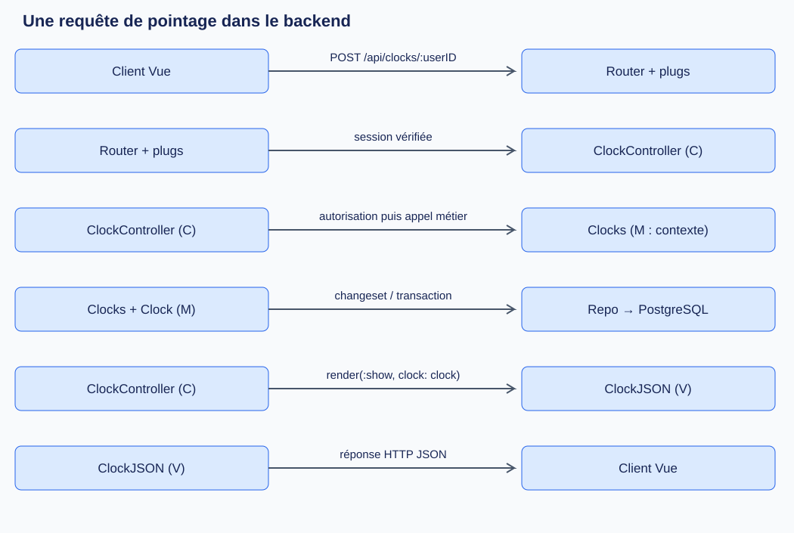
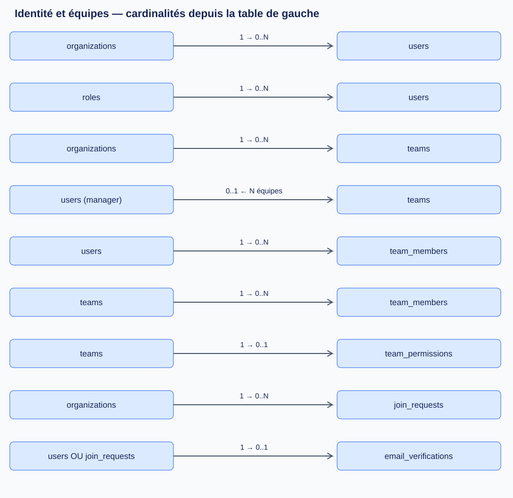
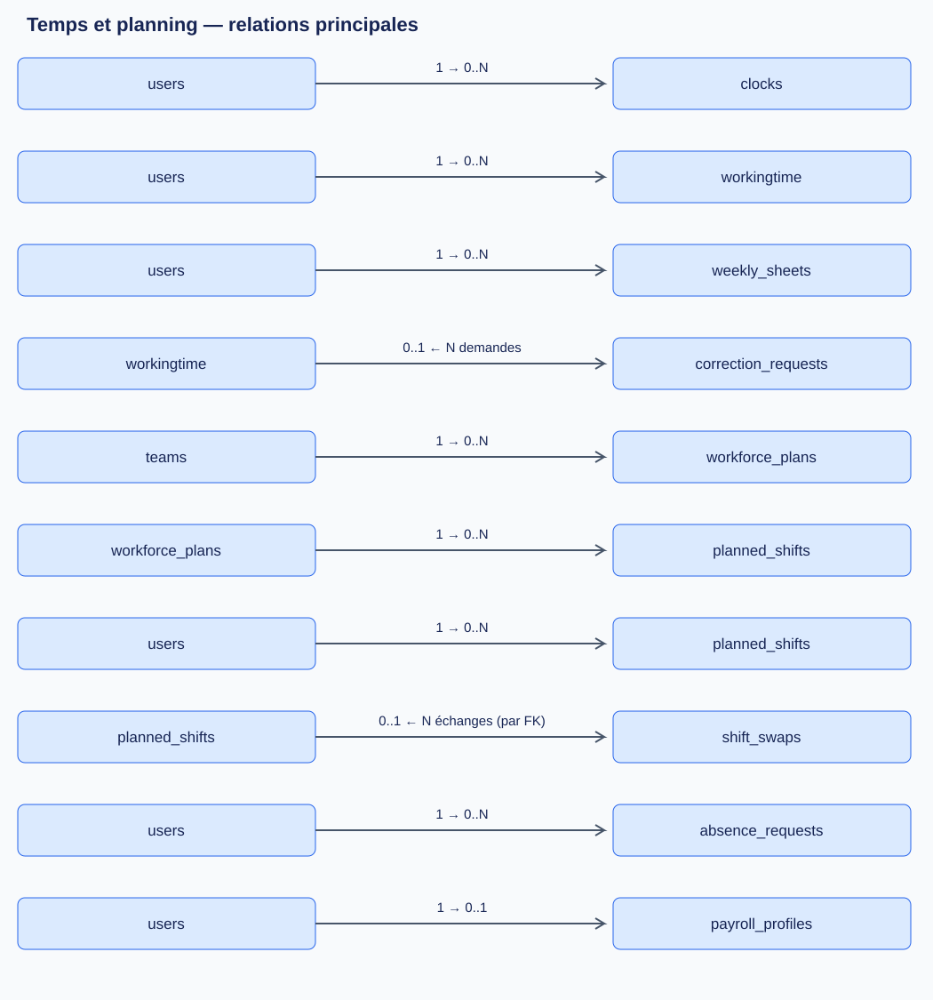

# Comprendre le backend : MVC, tables et sécurité

Ce guide explique le code présent dans `time_manager/`, examiné le **15 octobre 2026**. Les chemins de code sont relatifs à ce dossier. Il complète la [documentation technique du backend](BACKEND.md).

## 1. Comment MVC se traduit dans ce projet

**MVC** signifie **Modèle, Vue, Contrôleur**. Ici, Phoenix expose une API JSON consommée par le frontend Vue : la « vue » du backend prépare du JSON ; le frontend Vue affiche ensuite l'interface. Ce sont deux responsabilités différentes.

| Élément | Dans ce projet | Exemple pour un pointage |
|---|---|---|
| Modèle (M) | Contextes métier, schémas Ecto et accès aux données | `Clocks` porte les règles ; `Clocks.Clock` décrit les données ; `Repo` accède à PostgreSQL. |
| Vue (V) | Modules de présentation `*JSON`, ou réponse construite avec `json/2` | `ClockJSON` choisit les champs du pointage envoyés au client. |
| Contrôleur (C) | Modules `*Controller` | `ClockController.create/2` lit les paramètres, contrôle les droits et appelle `Clocks.create_clock/2`. |
| Routage et middleware | `router.ex`, `plugs/`, `endpoint.ex` | L'URL choisit le contrôleur ; les plugs vérifient notamment la session. |



Prenons `POST /api/clocks/42` :

1. Le routeur sélectionne `ClockController.create/2`, après les pipelines `:api` et `:auth`.
2. `Authenticate` identifie l'utilisateur et le place dans `conn.assigns.current_user`.
3. Le contrôleur transforme l'identifiant et appelle `Authorization.can_clock?/2` : seul l'utilisateur 42 peut pointer pour 42, même si l'appelant est administrateur.
4. Le contexte `Clocks` vérifie les transitions arrivée/pause/reprise/départ et écrit les données dans une transaction. Un départ peut aussi créer une période dans `workingtime`.
5. Le contrôleur appelle `render(:show, clock: clock)` ; `ClockJSON` prépare la réponse. `FallbackController` traduit les erreurs prises en charge en réponses HTTP.

Phoenix est donc utilisé avec **des contextes métier qui complètent MVC**. Un schéma Ecto n'est pas à lui seul tout le modèle : les règles se trouvent aussi dans `accounts.ex`, `clocks.ex`, `workforce.ex` et les contextes spécialisés.

## 2. Comment les schémas sont définis

Trois notions sont à distinguer :

| Notion | Emplacement | Rôle |
|---|---|---|
| Migration SQL via Ecto | `priv/repo/migrations/*.exs` | Crée ou modifie réellement les tables, colonnes, clés étrangères et contraintes dans PostgreSQL. |
| Schéma Ecto | `lib/time_manager/**` | Associe une structure Elixir à une table et décrit les types et, selon le module, les associations. |
| Schéma OpenAPI | `lib/time_manager_web/schemas/` | Décrit les requêtes et réponses HTTP pour la documentation API ; ne crée aucune table. |

Extrait de `accounts/user.ex` :

```elixir
schema "users" do
  field :email, :string
  field :password, :string, virtual: true, redact: true
  field :password_hash, :string, redact: true

  belongs_to :role, TimeManager.Accounts.Role
  belongs_to :organization, TimeManager.Organizations.Organization, type: :binary_id
  has_many :clocks, TimeManager.Clocks.Clock
  many_to_many :teams, TimeManager.Teams.Team, join_through: "team_members"
end
```

- `schema "users"` désigne la table SQL ; `field` décrit une propriété.
- `password` est **virtuel** : aucune colonne ne conserve le mot de passe en clair. `password_hash` contient son empreinte.
- `belongs_to :role` correspond à `users.role_id` ; `has_many :clocks` utilise `clocks.user_id`.
- `many_to_many` passe par une table intermédiaire, ici `team_members`.
- Un **changeset** sélectionne et valide les modifications. L'écriture arrive seulement avec `Repo.insert`, `Repo.update`, etc.

**Une association Elixir n'est pas une contrainte SQL.** Par exemple, `Workforce.Permission` déclare `field :team_id, :integer`, mais la migration impose bien une clé étrangère vers `teams`. Les migrations sont donc nécessaires pour connaître toutes les relations. `Repo.preload(user, :role)` permet de charger une association déclarée avant de lire `user.role.name`.

## 3. Combien de tables ?

Les migrations du dépôt créent **23 tables applicatives**, table de liaison comprise. PostgreSQL contient aussi la table technique **`schema_migrations`**, gérée par Ecto pour suivre les migrations appliquées : soit **24 tables dans le schéma applicatif si toutes les migrations sont appliquées**, hors ajouts externes. Ce décompte vient du code, sans interrogation d'un serveur déployé.

Dans la suite, `1 → N` signifie « un parent peut avoir plusieurs enfants », et `1 → 0..1` « au maximum une ligne complémentaire par parent ». Une FK (*foreign key*, clé étrangère) désigne une ligne d'une autre table. Une FK nullable permet de ne pas avoir de parent ; un index unique empêche les doublons.

### 3.1 Identité, admission et sessions : 7 tables

| Table | Utilité | Relations et contraintes principales |
|---|---|---|
| `organizations` | Organisation, nom normalisé et référence privée | Parent des utilisateurs, équipes, demandes, règles et événements. Identifiant UUID. |
| `roles` | Rôles `employee`, `manager`, `administrator` | Un rôle pour plusieurs utilisateurs via `users.role_id` ; nom unique. |
| `users` | Identité, hash du mot de passe, vérification email et version de session | FK `role_id` et `organization_id` ; organisation facultative pour les comptes historiques ; email unique sans tenir compte de la casse. |
| `join_requests` | Demande d'adhésion avant création du compte | FK obligatoire `organization_id` ; FK facultative `reviewed_by_id → users` ; identifiant UUID. |
| `email_verifications` | Code de vérification email, expiration et tentatives | Exactement un propriétaire : `user_id → users` **ou** `join_request_id → join_requests` ; au maximum une ligne par propriétaire. |
| `password_recoveries` | Code de récupération du mot de passe, expiration et tentatives | `user_id` est à la fois PK (clé primaire) et FK : un utilisateur a zéro ou une récupération enregistrée. |
| `revoked_tokens` | Sessions terminées par déconnexion | PK `jti`, expiration ; **aucune FK vers `users`**. Le lien à la session se fait par l'identifiant du JWT. |

`Profile` est un module de validation et de présentation des champs personnels : **il n'existe pas de table `profiles`**.

### 3.2 Équipes : 3 tables

| Table | Utilité | Relations et contraintes principales |
|---|---|---|
| `teams` | Équipe et responsable | FK `organization_id → organizations` ; FK facultative `manager_id → users`. Un utilisateur peut diriger plusieurs équipes ; nom unique dans l'organisation. |
| `team_members` | Appartenance des utilisateurs aux équipes | FK obligatoires `team_id → teams`, `user_id → users` ; paire unique ; pas d'identifiant `id`. |
| `team_permissions` | Actions autorisées au manager : `validate`, `correct`, `publish` | FK obligatoire et unique `team_id → teams` : une équipe a zéro ou une ligne de permissions. |



**Utilisateurs ↔ équipes est une relation N:N** : Alice peut appartenir à deux équipes et une équipe peut contenir Alice et Bob. Chaque appartenance est une ligne de `team_members`. En revanche, `teams.manager_id` désigne le responsable : ce lien est distinct de l'appartenance. Le code et une migration retirent les managers des membres de leur propre équipe.

Dans les diagrammes, « `0..1 ← N` » signifie que chaque ligne à droite peut référencer zéro ou une ligne à gauche, et qu'une ligne à gauche peut être référencée plusieurs fois. Les tableaux détaillent aussi les relations secondaires omises des images.

### 3.3 Temps de travail : 3 tables

| Table | Utilité | Relations et contraintes principales |
|---|---|---|
| `clocks` | Événements de pointage | FK obligatoire `user_id → users` ; un utilisateur possède plusieurs événements. |
| `workingtime` | Intervalles travaillés avec début, fin et catégorie | FK obligatoire `user_id → users` ; nom SQL exact au singulier, même si le contexte s'appelle `WorkingTimes`. |
| `weekly_sheets` | Note et statut d'une semaine : `open`, `validated`, `closed` | FK obligatoire `user_id → users`, FK facultative `reviewer_id → users` ; paire `(user_id, week)` unique. |

Un pointage est un **événement**, une période est un **intervalle** : par exemple, arrivée à 9 h et départ à 17 h sont deux événements pouvant produire une période 9 h–17 h. Il n'existe pas de FK directe entre `clocks` et `workingtime`, ni entre `weekly_sheets` et les périodes : le métier utilise notamment l'utilisateur et les dates.

### 3.4 Corrections, planning, absences et paie : 6 tables

| Table | Utilité | Relations et contraintes principales |
|---|---|---|
| `correction_requests` | Proposition de nouveaux horaires avec copie des anciens | FK obligatoire `user_id → users` ; FK facultatives `period_id → workingtime`, `reviewer_id → users`. Plusieurs demandes historiques possibles, au maximum une demande `pending` par période. |
| `workforce_plans` | Planning, révision et copie publiée (`snapshot`) | FK obligatoire `team_id → teams` ; paire `(team_id, start)` unique. |
| `planned_shifts` | Créneaux affectés dans un planning | FK obligatoires `plan_id → workforce_plans`, `user_id → users` ; fin strictement après le début. |
| `shift_swaps` | Échanges proposés entre deux utilisateurs | FK obligatoires `user_id`, `target_user_id → users` ; FK facultatives `shift_id`, `target_shift_id → planned_shifts` et `reviewer_id → users`. Chaque FK de créneau définit une relation 1:N distincte. |
| `absence_requests` | Demandes d'absence, décision et heures rémunérables | FK obligatoire `user_id → users`, FK facultative `reviewer_id → users`. |
| `payroll_profiles` | Taux horaire et devise | FK obligatoire et unique `user_id → users` : zéro ou un profil par utilisateur. |



Il n'existe pas de table de bulletins de paie : le contexte `workforce/payroll.ex` calcule les résultats à partir des données et produit notamment un CSV.

### 3.5 Réglages, historique et notifications : 4 tables

| Table | Utilité | Relations et contraintes principales |
|---|---|---|
| `workforce_settings` | Règles métier dans le champ `rules` | FK obligatoire et unique `organization_id → organizations` : zéro ou une configuration par organisation. |
| `account_preferences` | Préférences dans le champ `settings` | FK obligatoire et unique `user_id → users` : zéro ou une configuration par utilisateur. |
| `workforce_events` | Journal d'audit : action et détails | FK facultatives `organization_id → organizations` et `actor_id → users` ; organisation nullable pour conserver les événements historiques sans organisation. |
| `workforce_notifications` | Notifications personnelles et date de lecture | FK obligatoire `user_id → users` : un utilisateur peut recevoir plusieurs notifications. |

Le total est donc **7 + 3 + 3 + 6 + 4 = 23 tables applicatives**.

### 3.6 Que se passe-t-il lors d'une suppression ?

Les migrations précisent `on_delete` pour chaque FK :

| Stratégie | Exemple réel | Effet |
|---|---|---|
| `:delete_all` | `clocks.user_id`, `team_members.user_id` | Supprimer le parent supprime les lignes enfants concernées. |
| `:nilify_all` | `weekly_sheets.reviewer_id`, `teams.manager_id` | La ligne reste, mais la référence devient `NULL`. |
| `:restrict` | `users.organization_id`, `users.role_id` | PostgreSQL refuse la suppression du parent tant que des lignes le référencent. |

Ainsi, supprimer un relecteur conserve les demandes des autres utilisateurs et efface sa référence de relecture. Supprimer le propriétaire d'une demande supprime sa demande. Une organisation ayant encore des utilisateurs ou des équipes ne peut pas être supprimée simplement en cascade.

## 4. Comment l'authentification fonctionne

**Authentifier**, c'est savoir qui appelle. **Autoriser**, c'est décider si cette personne peut effectuer l'action demandée sur la donnée ciblée.

### 4.1 Connexion et session

1. Le client appelle `POST /api/auth/login` avec email et mot de passe. `Accounts.authenticate/2` vérifie le mot de passe et exige un email vérifié.
2. `User.valid_password?/2` vérifie l'empreinte **Argon2id**. Les anciennes empreintes bcrypt restent acceptées et sont migrées après une connexion réussie. Le serveur retourne la même erreur pour un compte inconnu et un mauvais mot de passe.
3. Le serveur crée un jeton CSRF aléatoire, puis un **JWT signé en HS256**, valable **8 heures**. Il contient notamment `user_id`, `role`, `xsrf`, `session_version` et l'identifiant de jeton `jti`. La signature utilise `JWT_SECRET` ; le contenu n'est pas chiffré.
4. `AuthController` place le JWT dans un cookie `jwt`, **HttpOnly**, **SameSite=Strict**, chemin `/`, avec `Secure` en production. Le JSON de connexion fournit le jeton CSRF au frontend.
5. Pour une route protégée ordinaire, le navigateur transmet le cookie et le frontend ajoute `X-CSRF-Token`, **y compris pour les GET**.

`HttpOnly` empêche la lecture du cookie par JavaScript. Le jeton CSRF transmis séparément sert à vérifier que l'appelant connaît la valeur associée à la session.

### 4.2 Vérifications à chaque requête protégée

Le plug `lib/time_manager_web/plugs/authenticate.ex` vérifie successivement :

- présence du cookie, signature et validité temporelle du JWT ;
- correspondance entre `X-CSRF-Token` et la valeur `xsrf` signée ;
- absence du `jti` dans `revoked_tokens` ;
- existence actuelle de l'utilisateur, avec rechargement de son rôle depuis la base ;
- égalité entre la `session_version` du JWT et celle du compte.

Il place ensuite l'utilisateur dans `conn.assigns.current_user`. En cas d'échec, il arrête la requête avec **401**.

L'exception CSRF concerne uniquement `GET /api/auth/session` avec `X-Session-Restore: 1` : elle permet à un nouvel onglet de retrouver le jeton CSRF. Les contrôles du JWT, de révocation, du compte et de version de session restent appliqués ; les métadonnées de provenance sont également contrôlées.

### 4.3 Déconnexion, mot de passe et admission

- **Déconnexion** : `POST /api/auth/logout` enregistre le `jti` révoqué et retire le cookie. Une copie de ce JWT est alors refusée.
- **Changement ou réinitialisation du mot de passe** : le backend incrémente `users.session_version`, ce qui invalide les anciens JWT du compte. `password_recoveries` conserve le hash du code de récupération, son expiration et les tentatives.
- **Vérification email** : `email_verifications` conserve les informations de vérification pour un compte ou une demande d'adhésion, sans exiger qu'un compte existe déjà pour cette dernière.
- **Admission** : le routeur expose encore des URL de création, mais `AdmissionPolicyController` bloque les créations publiques d'organisation et de compte correspondantes. Le parcours d'adhésion passe par `join_requests` puis une décision d'administration ; une route présente n'implique donc pas une inscription libre autorisée.

`CheckOrigin` contrôle la provenance des écritures, y compris publiques. Les contrôleurs et pipelines ajoutent des limites de fréquence : les échecs correspondants produisent **429**. Ces protections complètent la session et les permissions.

## 5. Comment les permissions sont gérées

### 5.1 Rôle + périmètre + action

Il n'y a pas de table générique de permissions par utilisateur. Le backend combine :

- le rôle global dans `roles` et `users.role_id` ;
- l'organisation, le responsable d'équipe et les appartenances ;
- les trois indicateurs de `team_permissions` pour les actions métier ;
- les règles et l'état de la donnée, par exemple une semaine clôturée.

`lib/time_manager/authorization.ex` porte les droits généraux ; `lib/time_manager/workforce.ex` ajoute les contrôles métier. Les contrôleurs et contextes appliquent ces fonctions côté serveur : masquer un bouton dans le frontend ne suffit pas.

| Action | Employé | Manager | Administrateur |
|---|---|---|---|
| Pointer | Pour soi | Pour soi | Pour soi |
| Consulter profil et temps | Soi | Soi et membres des équipes dirigées | Utilisateurs de son organisation |
| Modifier un profil | Le sien | Le sien | Le sien et ceux de son organisation |
| Corriger directement les périodes | Non | Membres dirigés, avec `correct` | Autres utilisateurs de son organisation |
| Valider une feuille ou une demande de correction/absence | Non | Membres dirigés, avec `validate` | Autres utilisateurs de son organisation |
| Publier un planning | Non | Équipe dirigée, avec `publish` | Équipes de son organisation |
| Modifier le rôle d'un compte | Non | Non | Autre compte de son organisation |

Les états métier peuvent encore refuser une action autorisée par le rôle. Les comptes sans organisation restent dans un périmètre historique distinct ; ils ne sont pas automatiquement rattachés à une organisation.

### 5.2 Permissions d'équipe et absence d'auto-validation

Les valeurs par défaut sont `validate: true`, `correct: true`, `publish: false`. Elles sont également utilisées lorsqu'aucune ligne `team_permissions` n'existe. L'administrateur de l'organisation peut configurer ces permissions.

Exemple : Alice est manager de l'équipe A, Bob est membre de A, et `correct` vaut `true`. Alice peut corriger les périodes de Bob. Si `correct` passe à `false`, elle ne le peut plus. Si Bob appartient seulement à une équipe qu'Alice ne dirige pas, le rôle de manager d'Alice ne suffit pas.

`Workforce.allowed?/3` exige aussi `me.id != user_id` : **ni un manager ni un administrateur ne corrige directement ses propres périodes et ne valide sa propre feuille, correction ou absence**. Un autre responsable autorisé doit intervenir. Le périmètre d'organisation est contrôlé côté serveur ; changer l'identifiant dans l'URL ne donne pas accès aux données d'une autre organisation.

Une session absente ou invalide donne généralement **401** ; une session valide sans droit donne généralement **403**. Certaines recherches peuvent retourner **404** selon le parcours de chargement et les contrôles du contrôleur.

## 6. Où lire le code pour approfondir

| Sujet | Fichiers dans `time_manager/` |
|---|---|
| Parcours MVC concret | `lib/time_manager_web/router.ex`, `controllers/clock_controller.ex` et `controllers/clock_json.ex` sous `lib/time_manager_web/`, puis `lib/time_manager/clocks.ex` et `clocks/clock.ex` |
| Tables et contraintes | `priv/repo/migrations/` ; notamment les créations d'organisations, d'équipes et `20261012143436_add_workforce_workflows.exs` |
| Connexion, JWT et mots de passe | `lib/time_manager_web/controllers/auth_controller.ex`, `lib/time_manager/token.ex`, `lib/time_manager/accounts.ex`, `lib/time_manager/accounts/user.ex` |
| Vérification des sessions | `lib/time_manager_web/plugs/authenticate.ex` |
| Autorisations générales et métier | `lib/time_manager/authorization.ex`, `lib/time_manager/workforce.ex`, `lib/time_manager/workforce/permission.ex` |
| Contrat HTTP détaillé | [Documentation API](API.md) |
