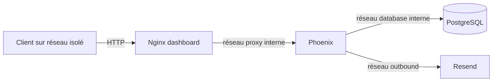
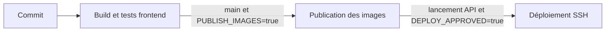

# DevOps — du poste local au serveur

Cette page décrit les conteneurs, les environnements et le pipeline réellement présents dans le dépôt. La configuration actuelle sert l'application en **HTTP**. Elle convient aux essais locaux et aux réseaux isolés, mais elle ne protège pas le trafic sur Internet.

!!! danger "Déploiement public bloqué"
    Aucun transport chiffré n'est fourni par le dépôt. Les identifiants et le cookie de session pourraient être interceptés sur un réseau non fiable. Une solution externe devra être choisie, configurée et testée avant une exposition publique.

## Environnements

| Élément | Développement | Test | Serveur actuel |
|---|---|---|---|
| Backend | cible `development`, `MIX_ENV=dev` | `MIX_ENV=test` | cible `production`, `MIX_ENV=prod` |
| Frontend | Vite ou Nginx HTTP | `Dockerfile.test` | build Vue servi par Nginx HTTP |
| Base | PostgreSQL, port local 5433 | base isolée et jetable | PostgreSQL sans port publié |
| Courriel | Mailpit | adaptateur Swoosh Test | Resend |
| Entrée web | `127.0.0.1:8080` | aucune | port HTTP `PUBLIC_PORT`, 80 par défaut |
| Phoenix | `127.0.0.1:4000` | réseau Compose | aucun port publié |
| Mocks | possibles avec `npm run dev:demo` | utilisés par certains tests | refusés pendant le build |

## Images Docker

### Backend Phoenix

`time_manager/Dockerfile` contient trois cibles :

1. `base` installe Elixir et les outils nécessaires ;
2. `development` compile avec `MIX_ENV=dev` et lance `entrypoint.sh dev` ;
3. `production` compile avec `MIX_ENV=prod`, exécute `mix phx.digest`, utilise l'utilisateur non privilégié `app` et lance `entrypoint.sh prod`.

La cible serveur ne réutilise pas une compilation de développement. Les dépendances et routes réservées au développement ne sont pas incluses : `dev_routes` vaut `false`, et ni LiveDashboard ni la boîte aux lettres locale ne sont routés.

Au démarrage, `entrypoint.sh` :

1. vérifie le mode attendu ;
2. charge `runtime.exs` pour valider les variables ;
3. attend PostgreSQL ;
4. crée la base si nécessaire, applique les migrations et les seeds ;
5. lance Phoenix sans recompilation.

### Frontend Vue

`time-manager-dashboard/Dockerfile` :

1. installe les dépendances avec `npm ci` ;
2. construit Vue avec `npm run build` ;
3. exécute les tests dans la cible `checks` ;
4. sert le dossier `dist/` avec Nginx dans les cibles `development` et `production`.

La cible `production` désigne ici un **build optimisé de Vue servi en HTTP**. Elle ne configure aucun certificat et n'ouvre aucun port chiffré.

## Pourquoi Nginx reste présent

Nginx est réellement utilisé par le projet. Dans le conteneur `dashboard`, il remplit deux fonctions :

- servir les fichiers compilés de Vue ;
- transmettre les chemins `/api/...` au conteneur Phoenix.

Le supprimer demanderait de choisir un autre serveur de fichiers et un autre proxy pour `/api`. Le dépôt ne contient pas ce remplacement. Le fichier actif est `time-manager-dashboard/nginx.conf`.

Cette configuration ajoute également :

- une limite de 64 Kio pour le corps des requêtes ;
- une limite de débit globale sur `/api` ;
- les en-têtes CSP, `nosniff`, `DENY` et `no-referrer` ;
- le refus des chemins cachés comme `/.env` ;
- des en-têtes proxy remplacés avant l'envoi à Phoenix.

## Topologie serveur actuelle



Dans `docker-compose.prod.yml` :

- `db` rejoint uniquement le réseau interne `database` ;
- `phoenix` rejoint `database`, `proxy` et `outbound` ;
- `dashboard` rejoint `public` et `proxy` ;
- seul `dashboard` publie le port HTTP ;
- Mailpit est absent ;
- l'adresse interne `172.30.7.10` identifie le proxy autorisé.

`TrustedProxy` accepte les informations réseau uniquement depuis cette adresse. Cela empêche un client direct de choisir librement sa propre adresse IP dans les en-têtes.

## Variables du serveur

Le modèle `.env.production.example` contient seulement des champs vides et des indications.

| Variable | Rôle |
|---|---|
| `DOCKER_USERNAME` | Préfixe des deux images du registre. |
| `IMAGE_TAG` | SHA Git de 40 caractères commun aux images. |
| `PGUSER`, `PGPASSWORD`, `PGDATABASE` | Initialisation du conteneur PostgreSQL. |
| `DATABASE_URL` | Connexion PostgreSQL complète avec identifiants. |
| `JWT_SECRET` | Signature des JWT, 32 octets minimum. |
| `SECRET_KEY_BASE` | Secret Phoenix, 64 octets minimum. |
| `PHX_HOST` | Nom d'hôte attendu, sans protocole, port ni chemin. |
| `PUBLIC_PORT` | Port HTTP publié, 80 par défaut. |
| `RESEND_API_KEY`, `RESEND_FROM` | Envoi des courriels sur le serveur. |
| `ADMIN_EMAIL`, `ADMIN_PASSWORD` | Seed facultatif du premier administrateur. |

Variables réservées à la CI : `DOCKER_PASSWORD`, `SERVER_IP`, `SERVER_USER`, `SSH_KEY`, `SSH_KNOWN_HOSTS`, `PUBLISH_IMAGES` et `DEPLOY_APPROVED`.

Les secrets réels restent hors Git. `scripts/write_deploy_env.py` les écrit dans un fichier de mode 600 sans afficher leurs valeurs.

## Pipeline Travis



### Test

Le stage construit :

- le backend de développement ;
- le backend de production ;
- la cible frontend `checks` ;
- l'image frontend serveur.

Le stage lance les tests Node dans l'image frontend. Il ne lance toujours pas `mix test` directement. Le workflow backend isolé doit être ajouté avant la publication pour éviter qu'une simple compilation soit considérée comme une validation métier.

### Publication

Sur `main`, avec `PUBLISH_IMAGES=true`, Travis construit les deux images `production`, les marque avec le SHA du commit et les publie dans le registre.

### Déploiement

Le déploiement exige aussi un lancement Travis par API et `DEPLOY_APPROVED=true`. Le job copie Compose, le fichier d'environnement privé et `deploy.sh`, puis exécute `deploy.sh --approved` sur le serveur.

Un push ordinaire ne déclenche donc pas de déploiement. Dans l'état actuel, l'équipe ne doit pas autoriser ce stage vers un serveur public tant qu'un transport chiffré n'a pas été ajouté en dehors du dépôt.

## GitHub Actions

Le workflow `.github/workflows/docs.yml` construit MkDocs en mode strict et publie GitHub Pages depuis `main`. Le workflow `.github/workflows/mirror.yml` synchronise la branche principale vers le dépôt miroir avec une clé dédiée.

## Exploitation locale ou isolée

### État et logs

```bash
docker compose ps
docker compose logs --tail=200 dashboard
docker compose logs --tail=200 phoenix
docker compose logs --tail=200 db
```

### Vérification HTTP

```bash
curl -I http://127.0.0.1:8080
curl -sS http://127.0.0.1:8080/api/openapi > /dev/null
docker compose ps
```

Ces commandes prouvent uniquement que les services locaux répondent. Elles ne prouvent pas que le transport convient à Internet.

### Sauvegarde PostgreSQL

Aucun script de sauvegarde n'est présent. Exemple manuel à adapter :

```bash
docker compose exec -T db pg_dump -U "<PGUSER>" -d "<PGDATABASE>" -Fc > "backup-$(date +%Y%m%d-%H%M%S).dump"
```

Une sauvegarde utile doit être copiée hors de la machine et testée par une restauration.

### Restauration

À utiliser uniquement sur une base cible explicitement vérifiée :

```bash
docker compose exec -T db pg_restore --clean --if-exists -U "<PGUSER>" -d "<PGDATABASE>" < <FICHIER_BACKUP>
```

### Retour à une image précédente

1. choisir un SHA déjà testé et encore disponible ;
2. sauvegarder la base ;
3. remplacer `IMAGE_TAG` dans le fichier privé du serveur ;
4. exécuter `docker compose pull` puis `docker compose up -d --remove-orphans` ;
5. vérifier les logs et les parcours essentiels.

Une migration incompatible peut empêcher ce retour. Le dépôt ne contient aucun rollback automatique.

## Risques encore ouverts

| Priorité | Risque | Action attendue |
|---|---|---|
| Critique | Transport HTTP non chiffré. | Ne pas exposer publiquement ; choisir et tester une protection externe avant déploiement. |
| Critique | `bandit 1.12.5` signalé pour `CVE-2026-105659` et `CVE-2026-105660`. | Confirmer la version corrigée, mettre à jour `mix.lock` et rejouer les tests. |
| Critique | Aucune sauvegarde ni restauration automatisée. | Définir une tâche, une rétention et un exercice de restauration. |
| Critique | Aucun healthcheck dans Compose serveur. | Ajouter des contrôles PostgreSQL, Phoenix et dashboard. |
| Haute | Tests backend absents de Travis. | Ajouter `scripts/check_workflows.sh backend` avant Publish. |
| Haute | Limiteur ETS local à une instance. | Prévoir un stockage partagé ou une limite externe si plusieurs instances sont lancées. |
| Haute | Aucun rollback automatique. | Ajouter contrôles de santé et procédure compatible avec les migrations. |

## Informations non trouvées dans le dépôt

- protection de transport utilisée par un éventuel serveur réel ;
- pare-feu et ports réellement ouverts ;
- état des secrets Travis ;
- sauvegardes réellement exécutées ;
- supervision, métriques et alertes externes.
