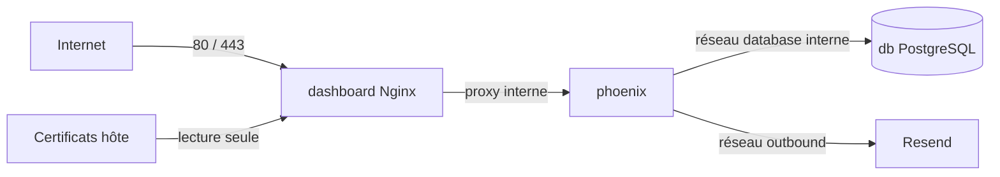

# DevOps — du poste local au serveur

Cette page répond à trois questions concrètes : quelle version de l'application est construite, quels services sont exposés et que se passe-t-il lorsqu'un déploiement est autorisé.

Le dépôt décrit et automatise une partie du trajet. Il ne donne aucune preuve sur l'état actuel du serveur, du domaine ou du certificat. Ces éléments externes sont signalés comme **Point à confirmer**.

## Matrice des environnements

Les trois environnements ont des objectifs différents. Le développement privilégie le rechargement rapide et les outils locaux. Le test utilise une base jetable. La production compile en mode `prod`, retire les outils de développement et publie uniquement l'entrée HTTPS.

| Élément | Développement | Test | Production |
|---|---|---|---|
| Backend Docker | cible `development`, `MIX_ENV=dev` | image backend + commande `MIX_ENV=test` | cible `production`, `MIX_ENV=prod` |
| Frontend | cible Nginx `development` ou Vite | `Dockerfile.test` | cible Nginx `production` |
| Base | PostgreSQL, volume `db_data`, port local 5433 | `test-db` isolée, volume jetable | PostgreSQL, volume `db_data`, aucun port publié |
| Courriel | Mailpit local | adaptateur Swoosh Test | Resend obligatoire |
| Entrée web | HTTP local | aucune entrée publique | Nginx sur 80/443, redirection HTTPS |
| Phoenix public | `127.0.0.1:4000` | réseau Compose | aucun port publié |
| Mocks frontend | possibles avec `npm run dev:demo` | utilisés par certains tests | build refusé s'ils sont activés |
| Secrets Phoenix | `JWT_SECRET` obligatoire | `JWT_SECRET` obligatoire | JWT, Phoenix et base obligatoires |

## Images Docker

Une image Docker est le paquet exécutable de l'application. Le projet construit un paquet différent pour le travail local et pour la production, afin d'éviter qu'un outil de diagnostic ou une compilation `dev` arrive sur le serveur.

### Backend

`time_manager/Dockerfile` possède trois étapes logiques :

1. `base` installe Elixir, les outils de compilation et le client PostgreSQL ;
2. `development` fixe `MIX_ENV=dev`, récupère toutes les dépendances et utilise `entrypoint.sh dev` ;
3. `production` fixe `MIX_ENV=prod`, récupère seulement les dépendances de production, compile, exécute `mix phx.digest`, crée l'utilisateur non privilégié `app` et utilise `entrypoint.sh prod`.

L'image de production ne réutilise pas une compilation de développement. `phoenix_live_dashboard` est une dépendance `only: :dev`, `dev_routes` vaut `false` en production et `TimeManagerWeb.dev_routes()` n'ajoute alors ni dashboard ni mailbox.

Au démarrage du conteneur Phoenix, `entrypoint.sh` joue le rôle de contrôle avant ouverture. Il refuse un mode incohérent, vérifie la configuration, attend la base, applique les migrations et lance enfin le serveur.

L'entrypoint :

1. impose le mode reçu dans l'image ;
2. charge `runtime.exs` sans démarrer l'application afin de valider les variables ;
3. attend PostgreSQL, 60 tentatives maximum ;
4. exécute `ecto.create`, `ecto.migrate` et les seeds ;
5. lance `mix phx.server --no-compile`.

!!! note
    L'image utilise Mix en production, pas une release OTP. Cela fonctionne, mais conserve davantage d'outils et de fichiers qu'une release multi-stage minimale.

### Frontend

`time-manager-dashboard/Dockerfile` :

1. exécute `npm ci` et `npm run build` dans Node 22 ;
2. la cible `checks` ajoute `npm test` ;
3. la cible `development` sert `dist/` avec Nginx sur HTTP ;
4. la cible `production` ajoute le template Nginx TLS.

Le build échoue si un mock est actif ou si l'URL API de production n'est pas `/api`.

## Topologie Compose

En production, Nginx est le seul service directement joignable depuis l'extérieur. Il sert Vue et transmet les appels `/api` à Phoenix. Phoenix peut parler à PostgreSQL sur un réseau privé, tandis que la base ne publie aucun port sur Internet.



Dans `docker-compose.prod.yml` :

- `database` et `proxy` sont des réseaux `internal` ;
- `db` rejoint seulement `database` ;
- `phoenix` rejoint `database`, `proxy` et `outbound` ;
- `dashboard` rejoint `public` et `proxy` ;
- seul `dashboard` publie 80/443 ;
- Mailpit est absent ;
- le certificat hôte est monté en lecture seule ;
- l'adresse fixe du proxy `172.30.7.10` correspond à `TRUSTED_PROXY_IP`.

## HTTPS et proxy de confiance

Nginx reçoit la connexion HTTPS et transmet la requête à Phoenix sur le réseau Docker interne. Il ajoute l'adresse et le protocole d'origine. Phoenix n'accorde sa confiance à ces informations que lorsqu'elles viennent de l'adresse interne Nginx prévue par la configuration.

Le template Nginx de production :

- redirige HTTP vers `https://<PHX_HOST>:<HTTPS_PORT>` avec 308 ;
- accepte TLS 1.2 et 1.3 ;
- désactive les tickets de session ;
- ajoute HSTS, CSP, `nosniff`, `DENY` et `no-referrer` ;
- limite le corps à 64 Kio et applique un débit global à `/api` ;
- remplace `X-Real-IP`, `X-Forwarded-For` et `X-Forwarded-Proto`.

Phoenix n'accepte ces informations que si l'adresse source correspond exactement à `TRUSTED_PROXY_IP`. En production, `SecurityHeaders` refuse toute requête dont le schéma corrigé n'est pas HTTPS.

### Préparer un certificat

Le dépôt sait utiliser un certificat déjà présent, mais il ne le demande pas et ne le renouvelle pas. La mise en service demande donc les étapes externes suivantes :

1. faire pointer le DNS du domaine réel vers le serveur ;
2. ouvrir temporairement ou durablement les ports 80 et 443 ;
3. obtenir `fullchain.pem` et `privkey.pem` avec le client ACME choisi ;
4. placer les fichiers dans un dossier lisible par Docker mais non versionné ;
5. définir `TLS_CERT_DIR=<DOSSIER_CERTIFICAT>` et `PHX_HOST=<DOMAINE_REEL>` ;
6. automatiser le renouvellement et le rechargement Nginx ;
7. vérifier depuis un autre réseau la chaîne du certificat et la redirection.

**Point à confirmer** : fournisseur DNS, méthode ACME, domaine, renouvellement et certificat réels.

## Variables de production

Le modèle `.env.production.example` est une liste de contrôle. Il doit être copié hors Git et renseigné sur le serveur ou par la CI. Les valeurs réelles restent secrètes et ne doivent jamais remplacer les placeholders dans la documentation.

| Variable | Exigence vérifiée par le code |
|---|---|
| `DOCKER_USERNAME` | Nom de compte Docker conforme au script et préfixe des deux images. |
| `IMAGE_TAG` | SHA Git de 40 caractères dans `write_deploy_env.py`. |
| `PGUSER`, `PGPASSWORD`, `PGDATABASE` | Obligatoires pour le conteneur PostgreSQL. |
| `DATABASE_URL` | URL PostgreSQL complète, valide et avec identifiants. |
| `JWT_SECRET` | 32 octets minimum, sans espaces et différente des anciennes clés publiques. |
| `SECRET_KEY_BASE` | 64 octets minimum, mêmes restrictions. |
| `PHX_HOST` | Domaine sans protocole, port ni chemin. |
| `HTTPS_PORT` | 443 par défaut, entre 1 et 65535. |
| `TLS_CERT_DIR` | Dossier hôte avec `fullchain.pem` et `privkey.pem`. |
| `RESEND_API_KEY`, `RESEND_FROM` | Obligatoires pour `EMAIL_DELIVERY=resend`. |
| `ADMIN_EMAIL`, `ADMIN_PASSWORD` | Facultatifs ; seed du premier administrateur sans organisation. |

Variables CI supplémentaires : `DOCKER_PASSWORD`, `SERVER_IP`, `SERVER_USER`, `SSH_KEY`, `SSH_KNOWN_HOSTS`, `PUBLISH_IMAGES` et `DEPLOY_APPROVED`.

`SSH_KNOWN_HOSTS` doit contenir une empreinte vérifiée hors bande. Le pipeline n'utilise pas `ssh-keyscan` pour le serveur de production.

## Pipeline Travis réel

Le pipeline avance par portes successives. Un commit est d'abord construit et testé. Les images peuvent ensuite être publiées lorsque la variable prévue l'autorise. Le déploiement exige une seconde autorisation explicite et un lancement par API.


### Stage Test

- construit la cible backend de développement ;
- construit la cible backend de production ;
- construit la cible frontend `checks`, qui lance `npm test` après le build ;
- construit la cible frontend de production.

Le stage vérifie donc les constructions Docker et les tests Node. Il **n'exécute pas `mix test`** dans `.travis.yml`.

### Stage Publish

Conditions : branche `main`, pas une pull request, `PUBLISH_IMAGES=true`.

- connexion au registre ;
- construction des deux cibles `production` ;
- tag des images avec `$TRAVIS_COMMIT` ;
- publication des images backend et frontend.

### Stage Deploy

Conditions supplémentaires : build lancé avec `type = api` et `DEPLOY_APPROVED=true`.

- charge une clé SSH temporaire ;
- écrit `.env.deploy` en mode 600 sans afficher les valeurs ;
- copie Compose, `.env` et `deploy.sh` ;
- exécute `deploy.sh --approved` ;
- supprime le fichier temporaire de la VM Travis.

Un push ordinaire **ne déclenche pas le déploiement**. Cette séparation réduit le risque d'envoyer par erreur une révision sur le serveur.

## GitHub Actions

### Documentation

`.github/workflows/docs.yml` installe Material for MkDocs, construit avec `--strict` et publie GitHub Pages lorsque `docs/**`, `mkdocs.yml` ou le workflow changent sur `main`. Le job est limité au dépôt `MscProgramm/Theme_5_authentification_security`.

### Miroir

`.github/workflows/mirror.yml` force la branche `main` du dépôt miroir depuis `origin/main`. Il utilise `MIRROR_SSH_PRIVATE_KEY` et `MIRROR_REPO_URL`.

!!! warning
    Ce push forcé réécrit la branche du miroir. La clé de miroir doit être dédiée et limitée au dépôt cible.

## Exploitation

Lorsqu'un incident arrive, commencez par vérifier l'état des conteneurs, puis leurs derniers logs. Conservez les messages d'erreur utiles avant de redémarrer : ils expliquent souvent la cause que le redémarrage ferait disparaître.

### État et logs

```bash
docker compose ps
docker compose logs --tail=200 dashboard
docker compose logs --tail=200 phoenix
docker compose logs --tail=200 db
docker compose logs -f phoenix
```

Le backend ajoute un `request_id` aux logs. **Information non trouvée dans le dépôt** : agrégation centralisée, rétention des logs, métriques externes et alertes.

### Vérification après démarrage

```bash
docker compose config --quiet
curl -I http://<DOMAINE_REEL>
curl -I https://<DOMAINE_REEL>
curl -sS https://<DOMAINE_REEL>/api/openapi > /dev/null
docker compose ps
```

Attendus : redirection 308 en HTTP, certificat valide en HTTPS, réponse OpenAPI et conteneurs en cours d'exécution. La présence d'une réponse ne valide pas les parcours authentifiés.

### Sauvegarde PostgreSQL

Il n'existe aucun script de sauvegarde dans le dépôt. Exemple manuel à adapter et tester :

```bash
docker compose exec -T db pg_dump -U "<PGUSER>" -d "<PGDATABASE>" -Fc > "backup-$(date +%Y%m%d-%H%M%S).dump"
```

Le fichier doit être chiffré, copié hors du serveur et soumis à une politique de rétention.

### Restauration

À exécuter uniquement sur une base cible explicitement vérifiée :

```bash
docker compose exec -T db pg_restore --clean --if-exists -U "<PGUSER>" -d "<PGDATABASE>" < <FICHIER_BACKUP>
```

**Point à confirmer** : procédure validée par l'équipe, fréquence, rétention, chiffrement et dernier test de restauration.

### Rollback applicatif

Les images immuables portent le SHA du commit. Un retour applicatif manuel consiste à :

1. choisir un SHA précédemment testé et encore disponible dans le registre ;
2. sauvegarder la base ;
3. remplacer `IMAGE_TAG` dans le `.env` du serveur ;
4. exécuter `docker compose pull` puis `docker compose up -d --remove-orphans` ;
5. vérifier les logs et les parcours essentiels.

Il n'existe pas de rollback automatique. Une migration non rétrocompatible peut empêcher le retour à l'ancienne image ; dans ce cas, la restauration de la base doit suivre une procédure préparée avant le déploiement.

## Lacunes d'exploitation

| Priorité | Lacune | Action |
|---|---|---|
| Critique | Hex signale `bandit 1.12.5` vulnérable à `CVE-2026-105659` / `GHSA-69m6-wcv4-rwcf`. | Mettre à jour vers une version corrigée confirmée, tester puis reconstruire les images. |
| Critique | Aucune sauvegarde/restauration automatisée. | Ajouter tâche planifiée, chiffrement, copie distante et test de restauration. |
| Critique | Aucun healthcheck dans Compose production. | Ajouter des contrôles pour PostgreSQL, Phoenix et Nginx. |
| Haute | Tests backend absents du pipeline Travis. | Ajouter le workflow Docker isolé avant Publish. |
| Haute | Aucun rollback transactionnel ou blue/green. | Ajouter contrôle de santé et stratégie de retour compatible migrations. |
| Haute | Renouvellement TLS absent. | Automatiser ACME et recharger Nginx après renouvellement. |
| Moyenne | Déploiement par copie de fichiers dans `~`. | Utiliser un répertoire de version, permissions explicites et journal de déploiement. |
| Moyenne | `deploy.sh` n'attend aucun healthcheck après `up`. | Bloquer le job jusqu'à validation des services et endpoints essentiels. |

## Ce que le dépôt ne permet pas d'affirmer

- que les secrets Travis sont correctement renseignés ;
- que les images ont effectivement été publiées ;
- que le serveur distant utilise la dernière révision ;
- que le domaine et le certificat sont valides ;
- que les ports internes sont bloqués par le pare-feu hôte ;
- que les sauvegardes existent et sont restaurables.
