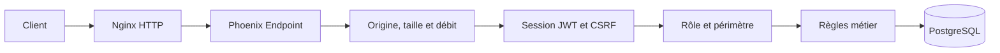

# Sécurité — protections réellement présentes

Cette page distingue les protections vérifiées dans le code des protections absentes ou non validées. Elle ne constitue pas un certificat de sécurité.

## Vue d'ensemble

Une requête passe par plusieurs contrôles :

Nginx sert l'interface et relaie `/api`. Phoenix reste l'autorité : il vérifie l'identité et les droits même lorsque Vue a déjà caché un bouton.

## Authentification

- les nouveaux mots de passe sont hachés avec Argon2id ;
- les anciens hashes bcrypt sont remplacés après une connexion réussie ;
- le JWT est signé en HS256 avec `JWT_SECRET` ;
- `JWT_SECRET` est obligatoire, sans valeur de secours et doit contenir au moins 32 octets ;
- le JWT expire après huit heures ;
- la déconnexion révoque son identifiant `jti` ;
- un changement ou une récupération de mot de passe invalide les anciennes sessions avec `session_version`.

Le JWT est placé dans un cookie `HttpOnly` et `SameSite=Strict`. Le JavaScript du frontend ne peut pas lire directement ce cookie.

!!! warning "Limite actuelle"
    Le cookie ne porte pas l'attribut `Secure`, car le dépôt utilise HTTP. `HttpOnly` protège contre la lecture par JavaScript, mais ne chiffre pas le trafic réseau.

## CSRF et origine

À la connexion, Phoenix crée un jeton CSRF aléatoire lié au JWT. Le frontend le renvoie dans `X-CSRF-Token`. Le plug `Authenticate` compare les deux valeurs en temps constant.

`CheckOrigin` contrôle aussi le protocole, le nom d'hôte et le port des écritures. Une origine différente reçoit `403`.

La restauration de session d'un nouvel onglet est limitée à `GET /api/auth/session`, avec `X-Session-Restore: 1` et des métadonnées de navigation compatibles avec la même origine.

## Rôles et isolation

`Authenticate` recharge l'utilisateur et son rôle depuis PostgreSQL à chaque requête. Une rétrogradation ou une suppression prend donc effet sans attendre l'expiration du JWT.

`Authorization` combine le rôle et le périmètre :

- un employé pointe uniquement pour lui-même ;
- un manager agit uniquement sur les membres des équipes qu'il dirige encore ;
- un administrateur reste limité à son organisation ;
- un utilisateur ne peut pas valider ou corriger certaines de ses propres données ;
- les identifiants reçus dans l'URL sont comparés à la session.

Les contrôles sont appliqués dans les endpoints Phoenix. Les gardes Vue améliorent la navigation, mais ne servent pas de preuve d'autorisation.

## Injections et validation

- Ecto paramètre les valeurs utilisées dans les requêtes SQL ;
- les changesets contrôlent types, formats, longueurs et contraintes ;
- PostgreSQL applique également des clés étrangères, index uniques et contraintes ;
- Vue échappe les interpolations ordinaires ;
- aucune utilisation de `v-html` n'a été trouvée dans le frontend inspecté ;
- la CSP de Nginx limite les sources de scripts et les contenus incorporés.

Aucun moteur NoSQL n'est présent. Une future requête SQL brute ou une future utilisation de `v-html` devra être revue séparément.

## Abus et volume de données

- limite globale par IP ;
- limites par utilisateur connecté ;
- limite renforcée sur les écritures ;
- limites par email sur les parcours sensibles ;
- réponse `429` avec `Retry-After` ;
- corps JSON limité à 64 Kio ;
- paramètres et périodes bornés ;
- pagination des historiques de pointage ;
- transactions et verrous PostgreSQL pour les actions concurrentes.

Le limiteur utilise ETS. Ses compteurs disparaissent au redémarrage et ne sont pas partagés entre plusieurs instances Phoenix.

## Secrets et mode production

La cible backend `production` compile et démarre réellement avec `MIX_ENV=prod`. Les routes LiveDashboard et mailbox ne sont pas incluses.

Le démarrage serveur refuse notamment :

- un `JWT_SECRET` absent, court ou connu publiquement ;
- un `SECRET_KEY_BASE` absent ou insuffisant ;
- une `DATABASE_URL` PostgreSQL invalide ;
- un `PHX_HOST` mal formé ;
- les variables Resend absentes lorsque ce fournisseur est activé.

Les modèles `.env.example` et `.env.production.example` ne contiennent aucun secret opérationnel.

## Transport réseau

Le dépôt utilise actuellement HTTP. Nginx ne possède plus de configuration de certificat ni de redirection vers un port chiffré.

Conséquences :

- les mots de passe peuvent être interceptés sur un réseau non fiable ;
- le cookie JWT peut être intercepté pendant le transport ;
- l'application ne doit pas être exposée publiquement dans cet état ;
- la sécurité du transport reste à concevoir et à valider séparément.

## Vérifications exécutées

| Vérification | Résultat enregistré |
|---|---|
| Backend dans Docker isolé | 188 tests réussis après le passage à la configuration HTTP. |
| Frontend dans Docker isolé | 120 tests, ESLint et build Vite réussis après la modification. |
| Routes de production | Aucune route `/dev/dashboard` ou `/dev/mailbox`. |
| Documentation | Construction MkDocs stricte prévue après chaque modification. |

## Risques ouverts

| Priorité | Risque | État |
|---|---|---|
| Critique | Trafic HTTP non chiffré | Bloque une exposition publique. |
| Critique | `bandit 1.12.5` signalé par Hex pour `CVE-2026-105659` et `CVE-2026-105660` | Mise à jour encore nécessaire. |
| Critique | Sauvegarde et restauration non automatisées | Procédure d'équipe absente. |
| Critique | Healthchecks serveur absents | Compose ne mesure pas la santé applicative. |
| Haute | Tests backend absents du stage Travis | Le script isolé existe mais n'est pas appelé par Travis. |
| Haute | Limiteur local à une instance | Adaptation nécessaire pour plusieurs instances. |

## Formulation honnête pour une soutenance

> Phoenix vérifie la session, le rôle actuel et le périmètre à chaque requête. Les mots de passe sont hachés avec Argon2id, le JWT reste dans un cookie HttpOnly et un jeton CSRF protège les actions. Ecto paramètre les requêtes SQL et des limites ralentissent les abus. Le transport reste en HTTP et n'est donc pas prêt pour une exposition publique.
