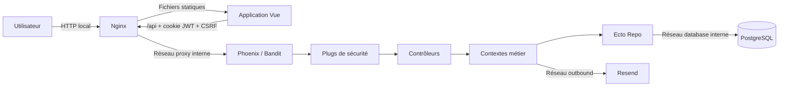

# Time Manager — comprendre le projet

Si vous découvrez le projet, retenez d'abord ces quatre rôles : **Vue affiche l'application, Nginx sert l'interface HTTP locale, Phoenix décide ce qui est autorisé et PostgreSQL conserve les données**.

Time Manager accompagne une journée de travail complète. Un employé rejoint une organisation, se connecte, pointe son arrivée, consulte son planning ou demande une correction. Un manager suit son équipe et valide les semaines. Un administrateur gère l'organisation, les droits et les éléments de paie.

Cette documentation s'appuie sur le code présent dans le dépôt au **15 octobre 2026**. Elle décrit donc ce que cette version sait faire. Elle ne permet pas de garantir qu'un serveur distant exécute exactement cette version. Lorsqu'une information ne peut pas être vérifiée dans le dépôt, elle est marquée **Point à confirmer**.

!!! tip "Choisir le bon point de départ"
    Pour lancer le projet, allez directement à [Installation](INSTALLATION.md). Pour suivre un clic jusqu'à la base de données, ouvrez [Architecture et flux](ARCHITECTURE.md). Pour préparer un serveur, commencez par [DevOps](DEVOPS.md).

## Acteurs et périmètre

Chaque personne voit une partie différente de l'application. Les droits réels sont contrôlés par Phoenix à chaque requête, même si l'interface masque déjà les boutons inutiles.

| Acteur | Capacités principales confirmées par le code |
|---|---|
| Employé | Pointer pour lui-même, consulter ses données, demander une correction, consulter son planning, proposer un échange et demander une absence. |
| Manager | Consulter les membres de ses équipes et agir selon les permissions `correct`, `validate` et `publish`. Le rôle actif est relu en base à chaque requête. |
| Administrateur | Administrer les membres, équipes, règles et paie de sa propre organisation. Il ne peut pas agir sur une autre organisation. |
| Visiteur | Se connecter, demander une récupération de mot de passe, rechercher l'organisation et suivre une demande d'adhésion avec une référence privée. |

!!! note "Application mobile"
    Aucun projet Cordova, Capacitor, Android ou iOS n'est présent dans ce dépôt. **Information non trouvée dans le dépôt** : comportement hors ligne, stockage natif et synchronisation mobile.

## Composants

On peut voir l'application comme un bâtiment. Vue est l'accueil visible par l'utilisateur. Nginx distribue les pages et transmet `/api`. Phoenix contrôle les demandes. PostgreSQL est la salle d'archives. Le tableau suivant donne le nom technique de chaque partie et le fichier où commencer sa lecture.

| Composant | Technologie | Responsabilité | Entrée principale |
|---|---|---|---|
| Dashboard | Vue 3, Vue Router, Vite | Interface, navigation, états de chargement, formulaires et appels HTTP. | `time-manager-dashboard/src/main.js` |
| Serveur web | Nginx | Sert le build Vue en HTTP et transmet `/api` à Phoenix. | `time-manager-dashboard/nginx.conf` |
| API | Elixir 1.17, Phoenix 1.8, Bandit | Authentification, autorisations, règles métier et réponses JSON. | `time_manager/lib/time_manager_web/endpoint.ex` |
| Domaine | Contextes Elixir | Comptes, équipes, pointages, heures et workflows. | `time_manager/lib/time_manager/` |
| Persistance | Ecto, PostgreSQL 16 | Données, transactions, contraintes et migrations. | `time_manager/priv/repo/migrations/` |
| Courriel | Swoosh/SMTP en local, Resend en production | Codes de vérification, récupération et notifications de sécurité prévues par le code. | `email_delivery.ex`, `resend.ex` |
| CI/CD | Travis CI, Docker, GitHub Actions | Builds, publication conditionnelle des images, déploiement approuvé, documentation et miroir. | `.travis.yml`, `.github/workflows/` |

## Architecture globale

Le schéma se lit de gauche à droite. Une action part du navigateur, traverse les contrôles de sécurité, atteint la règle métier, puis est enregistrée en base. La réponse refait le chemin inverse pour mettre l'écran à jour.



En développement, Vite ou Nginx transmet `/api` à Phoenix. Dans la composition serveur, seul Nginx publie le port HTTP ; Phoenix et PostgreSQL restent sur des réseaux Docker internes.

!!! danger "Transport non chiffré"
    Le dépôt ne configure plus de transport chiffré. La composition serveur actuelle convient à un environnement local ou isolé. Elle n'est pas prête pour une exposition publique, car les mots de passe et cookies circuleraient en clair sur le réseau.

## Le trajet d'une action

Prenons un pointage d'arrivée. L'employé clique sur le bouton dans Vue. Le navigateur envoie la demande à `/api` avec le cookie de session et la preuve CSRF. Phoenix vérifie alors l'identité, le rôle, l'organisation, la taille de la demande et la fréquence des appels. Le contrôleur confirme que l'employé pointe pour son propre compte, puis le contexte `Clocks` vérifie que la transition est cohérente.

Ecto prépare enfin l'écriture et PostgreSQL l'enregistre dans une transaction. Phoenix renvoie la donnée créée. Vue relit l'historique du serveur et affiche l'état confirmé. Ainsi, l'écran guide l'utilisateur, tandis que la décision finale reste toujours côté serveur.

!!! note "À retenir"
    Un bouton caché n'est jamais considéré comme une protection. Une personne peut appeler l'API directement. Phoenix refait donc les contrôles même lorsque Vue a déjà limité l'interface.

Les diagrammes détaillés se trouvent dans [Architecture et flux](ARCHITECTURE.md).

## Démarrer sans se perdre

### Démarrage local

```bash
cp .env.example .env
# Renseigner JWT_SECRET avec une valeur locale privée d'au moins 32 octets.
docker compose up -d --build
```

Interface : `http://127.0.0.1:8080`. API : `http://127.0.0.1:4000`. Mailpit : `http://127.0.0.1:8025`.

### Vérifications

```bash
bash scripts/check_workflows.sh backend
bash scripts/check_workflows.sh frontend
mkdocs build --strict
```

Les commandes détaillées et les variantes sans Docker sont dans [Installation](INSTALLATION.md).

### Vérifications exécutées le 15 octobre 2026

Ces résultats décrivent les commandes réellement exécutées sur une copie locale isolée. Ils montrent que la version testée fonctionne dans cet environnement. Ils ne constituent pas une preuve de sécurité complète.

| Vérification | Résultat réel |
|---|---|
| Backend Docker isolé | Compilation, migrations et **188 tests réussis**. |
| Frontend local et Docker | ESLint, **120 tests réussis** et build Vite réussi. |
| Image frontend serveur | Build Vue servi par Nginx HTTP, construit localement. |
| Compose production | `docker compose config --quiet` réussi avec des placeholders de test. |
| Routes backend de production | `mix phx.routes` exécuté dans l'image ; aucune route `/dev/dashboard` ou `/dev/mailbox`. |
| Documentation | `mkdocs build --strict` réussi avec Material for MkDocs. |

Les tests frontend affichent des avertissements liés au port WebSocket des devtools dans les environnements isolés, sans échec de test. Ces résultats ne valident pas une infrastructure distante.

### Version serveur

- Le backend est compilé et démarré avec `MIX_ENV=prod`.
- `DATABASE_URL`, `SECRET_KEY_BASE`, `JWT_SECRET`, `PHX_HOST` et `TRUSTED_PROXY_IP` sont validés au démarrage.
- Le frontend de production interdit les mocks et impose `/api` sur la même origine.
- Nginx sert Vue en HTTP, transmet `/api`, limite le débit et remplace les en-têtes réseau transmis à Phoenix.
- Les images utilisent le SHA Git comme tag ; aucun `latest` n'est déployé par le pipeline actuel.
- Un push sur `main` peut publier les images si `PUBLISH_IMAGES=true`. Le déploiement exige un build Travis lancé par API et `DEPLOY_APPROVED=true`.

!!! warning "Validation externe indispensable"
    **Point à confirmer** : transport chiffré externe, ports du serveur, secrets CI, accès au registre, sauvegardes et restauration. Le dépôt ne prépare plus de certificat et ne doit pas être présenté comme prêt pour Internet.

## Protections visibles dans le code

La sécurité applicative repose sur plusieurs verrous successifs. Après Nginx, une requête doit encore passer les contrôles Phoenix, les règles métier et les contraintes de la base de données.

- mots de passe nouveaux hachés avec Argon2id, anciens bcrypt migrés après une connexion réussie ;
- JWT signé par une clé obligatoire, sans valeur de secours ;
- cookie JWT inaccessible au JavaScript grâce à `HttpOnly`, sans chiffrement du transport HTTP actuel ;
- CSRF lié au JWT et contrôle d'origine complet sur les écritures ;
- rôle et utilisateur relus en base à chaque requête ;
- isolation par organisation et équipe dans les contrôleurs/contextes ;
- limites globales, par utilisateur, par IP ou par e-mail ;
- corps JSON limité à 64 Kio et paramètres bornés ;
- pagination par curseur pour les historiques concernés ;
- transactions et verrous PostgreSQL pour les opérations concurrentes ;
- en-têtes de sécurité HTTP et paramètres sensibles filtrés des logs.

Ces protections réduisent les risques connus. Elles ne remplacent pas une revue indépendante, un test d'intrusion et la validation de l'infrastructure réellement déployée.

## Carte de la documentation

| Besoin | Page |
|---|---|
| Installer et lancer le projet | [Installation](INSTALLATION.md) |
| Comprendre les flux | [Architecture et flux](ARCHITECTURE.md) |
| Lire les contrats API et le modèle de données | [Backend et API](BACKEND.md) |
| Comprendre les écrans, routes et services | [Frontend](FRONTEND.md) |
| Vérifier les protections et risques | [Sécurité](SECURITE.md) |
| Construire, publier, déployer et exploiter | [DevOps](DEVOPS.md) |
| Résoudre une panne | [Dépannage](FAQ.md) |
| Comprendre le vocabulaire | [Glossaire](GLOSSAIRE.md) |

## Analyse critique priorisée

Cette partie sert à décider quoi traiter en premier. Une priorité **Critique** peut bloquer la mise en production. Une priorité **Haute** demande une correction planifiée avant d'exposer largement le service. Les priorités plus basses concernent surtout la robustesse et la maintenance.

| Priorité | Constat issu du dépôt | Conséquence | Action recommandée |
|---|---|---|---|
| Critique | Aucun transport chiffré n'est configuré dans le dépôt. | Les identifiants et cookies peuvent être lus sur un réseau non fiable. | Réserver cette composition au local ou placer un service de transport chiffré validé devant l'application avant toute exposition publique. |
| Critique | La résolution Hex du 15 octobre 2026 signale deux alertes sur `bandit 1.12.5` : `CVE-2026-105659` et `CVE-2026-105660`. | Risque de blocage de processus HTTP/2 et autorité HTTP/1 non validée. | Identifier la version corrigée publiée, mettre à jour `mix.lock`, puis rejouer compilation, tests et test de charge avant tout déploiement. |
| Critique | Aucun healthcheck dans `docker-compose.prod.yml`; `depends_on` ne garantit pas que PostgreSQL est prêt, même si l'entrypoint attend ensuite la base. | Le superviseur Docker ne peut pas signaler précisément un service applicatif malsain. | Ajouter des healthchecks PostgreSQL, Phoenix et Nginx, puis surveiller leur état. |
| Critique | Sauvegarde PostgreSQL, chiffrement des sauvegardes et test de restauration absents. | Une perte du volume peut devenir définitive. | Définir une sauvegarde automatisée, sa rétention et un exercice régulier de restauration. |
| Haute | Travis construit le backend mais n'exécute pas `mix test`; les tests complets existent seulement via `docker-compose.test.yml`. | Une régression métier peut être publiée si l'image compile. | Exécuter `bash scripts/check_workflows.sh backend` dans le stage Test avant publication. |
| Haute | Le limiteur ETS est local au processus et perdu au redémarrage. | Limites non partagées entre plusieurs instances et remises à zéro au redémarrage. | Utiliser Redis/PostgreSQL ou limiter également au proxy si plusieurs instances sont prévues. |
| Haute | `deploy.sh` applique migrations, seeds et redémarrage sans sauvegarde ni rollback automatique. | Retour arrière risqué lorsqu'une migration n'est pas rétrocompatible. | Ajouter pré-sauvegarde, contrôle de santé et procédure de restauration/version précédente. |
| Moyenne | Des actions mortes existent (`AuthController.register/2`, `OrganizationController.create/2`) alors que le routeur utilise `AdmissionPolicyController`. | Confusion entre contrat déclaré et chemin réellement accessible. | Supprimer ou isoler le code non routé après validation fonctionnelle. |
| Moyenne | Les formats de date des réponses ne sont pas uniformes entre ressources. | Parsing plus fragile dans les clients. | Standardiser toutes les sorties en ISO 8601 UTC avec `Z`. |
| Moyenne | Les seuils et données du journal ne sont pas tous archivés indéfiniment. | Historique incomplet à grande échelle. | Définir pagination, archivage et politique de rétention. |
| Faible | Aucun pourcentage de couverture n'est produit. | La profondeur réelle des tests n'est pas mesurée. | Ajouter un outil de couverture et un seuil discuté par l'équipe. |

## Informations non trouvées dans le dépôt

- solution de transport chiffré réellement utilisée ;
- inventaire du serveur, pare-feu et supervision externe ;
- politique de sauvegarde/restauration effectivement appliquée ;
- objectif de disponibilité et procédure d'astreinte ;
- rapport récent de test d'intrusion indépendant ;
- application mobile native et stratégie de synchronisation hors ligne.
